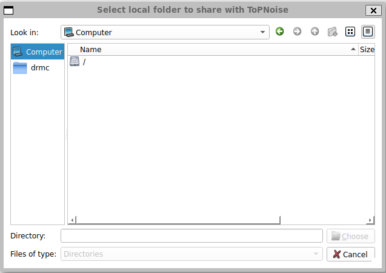
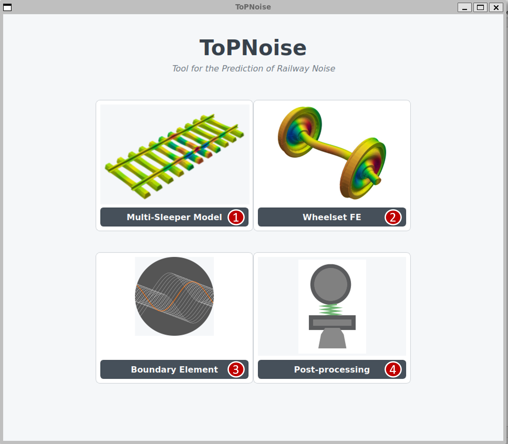

# 1. Getting started

## 1.1 Requirements

### 1.1.1 Operating system

ToPNoise has been tested on **Ubuntu 24.04 LTS, on 64-bit PCs (x86_64 / amd64)**. Later Ubuntu releases may also be used provided that the packages required by the installation script are available.

To check your operating system and architecture, open a terminal and type:

```bash
lsb_release -ds
uname -m
```

**Expected result**: the first command prints Ubuntu 24.04 LTS, a 24.04 point release, or a later Ubuntu release, and the second prints `x86_64`.

> **Windows users**: Ubuntu running inside Windows using WSL2 can also be used. It has been tested only briefly: the containers and the module windows start, but no full calculation has been checked.

### 1.1.2 Disk space

At least **10 GB of free disk space** is required for the ToPNoise installation. Additional disk space is required for calculation results. Depending on the calculation, the results of a full study can require several gigabytes.

> [!WARNING]
> **TODO:** Give a rough estimate of the required space for a given standard case.

### 1.1.3 Computing power

The ToPNoise calculations are computationally demanding and can take from minutes to hours. We recommend having at least **8 CPU cores** and **64 GB of RAM**. More computational power will reduce computation time.

### 1.1.4 Display

The ToPNoise launcher and the four modules use graphical interfaces and therefore require access to a display.

To check that a display is available, type:

```bash
echo $DISPLAY
```

**Expected result**: a value such as `:0`.

> [!WARNING]
> **TODO:** Remove the appendix on remote access until remote connection support is implemented and documented.

### 1.1.5 Internet connection

An internet connection is required during the installation to download the required system packages and the ToPNoise container images.

### 1.1.6 Administrator rights

Administrator rights (`sudo`) are required during the installation to install the necessary system packages.

## 1.2 Installation

### 1.2.1 Download ToPNoise

Open the ToPNoise repository on GitHub, click **Code**, and select **Download ZIP**.

Extract the downloaded ZIP file somewhere inside your Linux home directory.

The extracted folder is initially called `ToPNoise-main`. Rename it to `ToPNoise`.

Open a terminal and move to the folder where you extracted ToPNoise:

```bash
cd ~/path/to/ToPNoise
```

Replace the path above with the actual location of your ToPNoise folder.

All commands below are run from the ToPNoise folder.

### 1.2.2 Install ToPNoise

Run the installation script:

```bash
bash setup/install_singularity_linux.sh
```

The script installs Singularity and the system programs required to run ToPNoise. It uses `sudo` and may therefore ask for your password.

Then download the four ToPNoise container images:

```bash
bash setup/download_images.sh
```

The script creates the `images` folder and downloads the container images from the latest ToPNoise GitHub release.

The Boundary Element image is distributed in two parts. The script downloads both parts, joins them automatically into `topnoisebem.sif`, and removes the temporary files afterwards.

The `images` folder should contain:

```text
images/
├── MultiSleeperModel.sif
├── WheelToolbox.sif
├── topnoisebem.sif
└── Postprocessing.sif
```

Once both scripts complete without errors, continue to [section 1.3](#13-launching-topnoise) to launch the ToPNoise graphical user interface.

## 1.3 Launching ToPNoise

### 1.3.1 Start ToPNoise

Open a terminal, move to the ToPNoise folder, and run:

```bash
bash run.sh
```

When ToPNoise is launched for the first time, you are asked to select a folder to share with the ToPNoise modules.



The selected folder is accessible inside the ToPNoise containers as:

```text
/mnt/shared
```

The selected folder is saved and used again the next time ToPNoise is launched.

The ToPNoise launcher then opens:



### 1.3.2 ToPNoise modules

The launcher provides access to the four ToPNoise modules:

| Button | Module | Chapter |
|---|---|---|
| **Multi-Sleeper Model** | Track vibration | [2](02-track.md) |
| **Wheelset FE** | Wheelset vibration | [3](03-wheelset.md) |
| **Boundary Element** | Sound radiation | [4](04-bem.md) |
| **Post-processing** | Contact forces, rolling noise and pass-by levels | [5](05-postprocessing.md) |

Clicking a module opens a terminal window followed by the graphical interface of the selected module.

Keep the terminal window open while using the module. The terminal displays information about the calculation as well as possible error messages.
