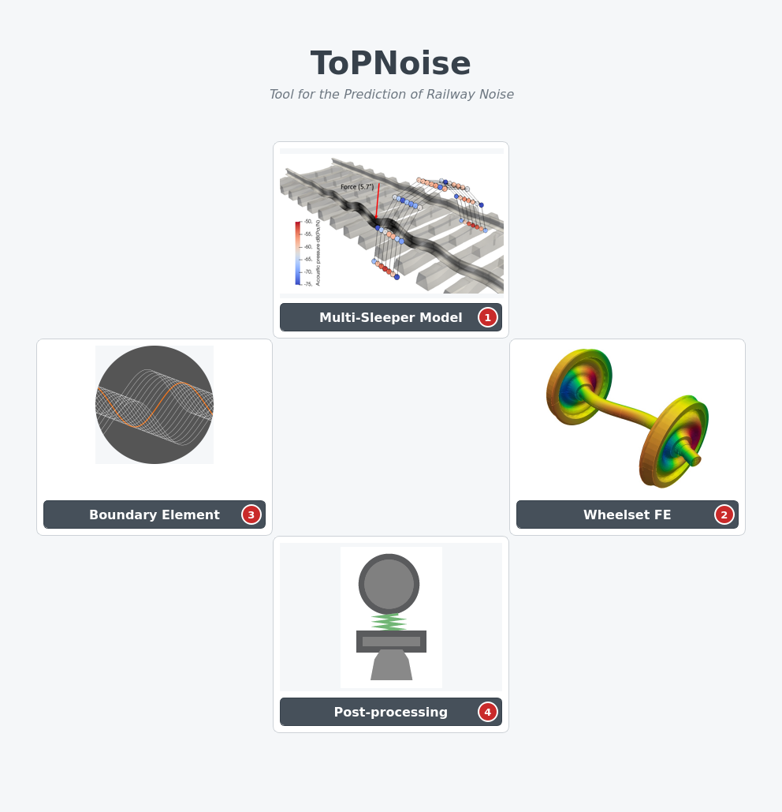

# 3. Launching ToPNoise

## 3.1 Start ToPNoise

Open a terminal, move to the ToPNoise folder, and run:

```bash
bash run.sh
```

When ToPNoise is launched for the first time, you are asked to select a folder to share with the ToPNoise modules.


The selected folder is accessible inside the ToPNoise containers as:

```text
/mnt/shared
```

The selected folder is saved and used again the next time ToPNoise is launched.

The ToPNoise launcher then opens:



## 3.2 ToPNoise modules

The launcher provides access to the four ToPNoise modules:

| Button | Module | Chapter |
|---|---|---|
| **Multi-Sleeper Model** | Track vibration | [4](04-track.md) |
| **Wheelset FE** | Wheelset vibration | [5](05-wheelset.md) |
| **Boundary Element** | Sound radiation | [6](06-bem.md) |
| **Post-processing** | Contact forces, rolling noise and pass-by noise | [7](07-postprocessing.md) |

Clicking a module opens a terminal window followed by the graphical interface of the selected module.

Keep the terminal window open while using the module. The terminal displays information about the calculation as well as possible error messages.
