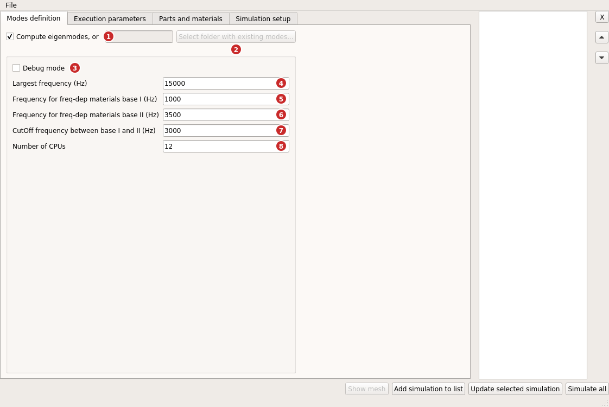
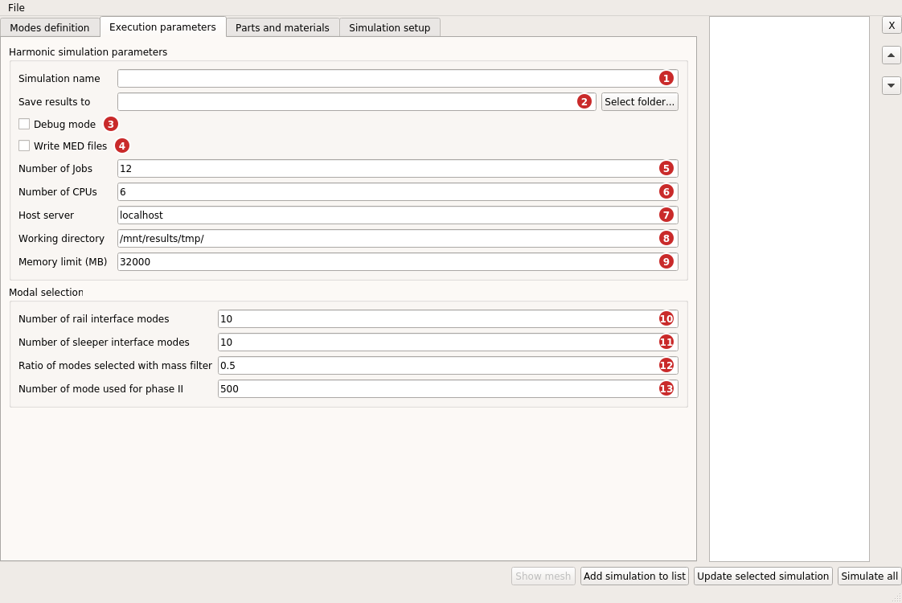
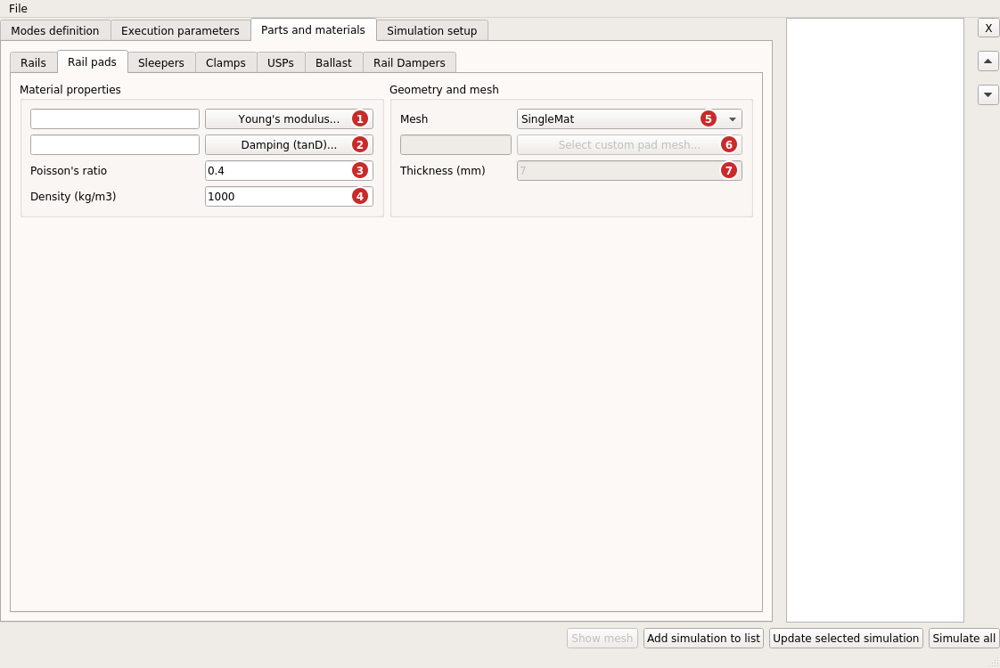
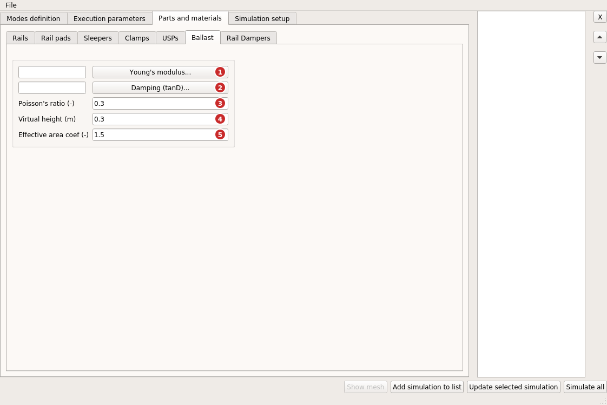
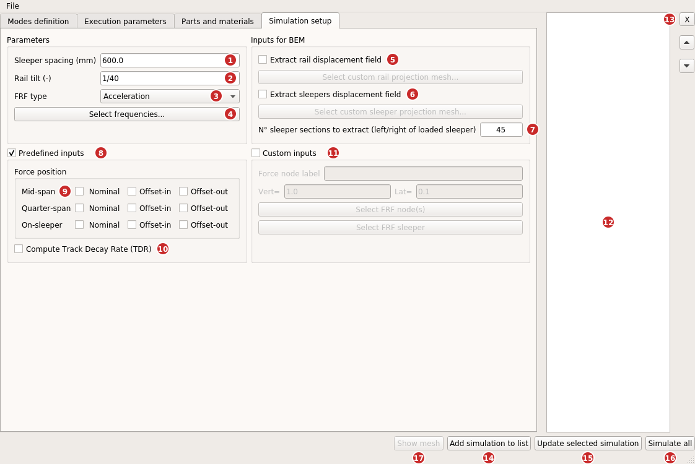

# 4. Track: Multi-Sleeper Model

**Checklist for this chapter**

- [ ] I have opened **Multi-Sleeper Model** from the launcher.
- [ ] On the **Modes definition** tab: I have ticked *Compute eigenmodes* (no modal basis exists yet for my parts and materials), or chosen the modes of an earlier simulation with exactly the same track.
- [ ] On the **Execution parameters** tab: I have named the simulation, chosen a results folder and a working directory that exist, and set the numbers of jobs and CPUs for my computer.
- [ ] On the **Parts and materials** tab: I have chosen the material files of the rail pad and of the ballast.
- [ ] On the **Simulation setup** tab: I have chosen the force positions, the FRF type and the frequencies, and ticked the extraction of the rail and sleeper displacement fields if I will run the Boundary Element module.
- [ ] I have clicked **Add simulation to list**, then **Simulate all**.
- [ ] The result folders contain the files of section 4.9.

## 4.1 What this module does

The Multi-Sleeper Model computes how a **railway track vibrates when a force acts at the wheel–rail contact**. It is a three-dimensional finite-element model of a long track, solved with Code_Aster.

- The track has **400 sleepers**, spaced by 600 mm by default, so it is 240 m long. The force acts on the **sleeper in the middle** of the track, the 201st. You cannot change these two values in the window.
- The track is built by assembling identical **macro-elements**, each made of one sleeper bay: a piece of rail, the rail pads and clamps, a sleeper, optionally an under-sleeper pad (USP), the ballast, and optionally rail dampers. The method is **dynamic substructuring**, in the frequency domain.
- The calculation has two phases:
  1. **Phase I — modes**: the vibration modes of one macro-element are computed once.
  2. **Phase II — harmonic response**: the response of the whole track to a force of 1 N is computed at each frequency, by assembling the macro-elements. The frequencies are divided into bands, and each band is a **job** that runs at the same time as the others.

For each force position that you choose, and for a vertical and a lateral force, it gives:

- the **contact FRFs** of the track: the response at the contact point (used by the Post-processing module, chapter 7);
- optionally, the **displacement fields of the rail and of the sleepers** (used by the Boundary Element module, chapter 6);
- optionally, the **track decay rate** (TDR), and MED files to look at the results in a viewer.

> **This module needs a powerful computer.** The window says that the **RAM** used can reach **15 GB or more**, and its default memory limit is 32 000 MB of RAM **per job**. It uses several cores for as long as the calculation lasts.

<!-- TODO: measure the memory and the computation time of a typical calculation on the reference case. -->

## 4.2 What you need before you start

- A folder inside your home directory for the results, and an empty folder for the working files (section 4.5).
- Two **material files** for the rail pad and two for the ballast: the Young's modulus and the damping as a function of frequency. The module supplies a set of them (section 4.6).

## 4.3 Open the module

In the launcher, click **Multi-Sleeper Model** (chapter 3). A terminal window opens, then the window **Multi-sleeper model**.

The window has four tabs on the left: **Modes definition**, **Execution parameters**, **Parts and materials** (with seven tabs of its own) and **Simulation setup**. On the right it has the **list of simulations**, with the buttons **X** (delete), **▲** and **▼** (move) next to it, and below the window four buttons: **Show mesh**, **Add simulation to list**, **Update selected simulation** and **Simulate all**. They are always visible, whatever the tab.

> **The fields of the tab *Parts and materials* are greyed out at first.** They become available when you tick *Compute eigenmodes* on the first tab, because the modes depend on these parts and materials. The figures of this chapter are taken with this box ticked.

## 4.4 Step 1: the *Modes definition* tab



*Figure 4.1 — The Modes definition tab, with Compute eigenmodes ticked.*

1. **Compute eigenmodes**: tick it when **no modal basis exists yet for the parts and materials you want** (not only the very first time): the modes of the macro-element (Phase I) are then computed before the main calculation. **The modes change as soon as the rail type, a material or any other part changes**, so a new track needs new modes. Untick it only to **reuse the modes of an earlier simulation**: the track is then exactly the one of that simulation (section 4.10).
2. **Select folder with existing modes…**: for the reuse. Choose the folder `Modes` of an earlier simulation.
3. **Debug mode**: the terminal windows of the calculation do not close when they are finished, so that you can read them. Use it to look for an error. **The calculation continues only when you close these windows by hand.**
4. **Largest frequency (Hz)**: the modes are computed up to this frequency. According to the help text of the window, 15 000 Hz (the default) is enough for a calculation up to 1500 Hz, and with under-sleeper pads (USPs) 25 000 Hz is advised to get converged results up to 2000 Hz.
<!-- REVIEW: these values come from the tooltip of the window, not from a check. The default list of frequencies (Simulation setup) goes up to 2000 Hz, while the tooltip says 15 000 Hz is enough only up to 1500 Hz. Please confirm the values (with and without USPs) and whether the defaults are consistent. -->
5. **Frequency for freq-dep materials base I (Hz)** and
6. **Frequency for freq-dep materials base II (Hz)**: the harmonic calculation uses materials (the rail pads, the ballast) whose properties **depend on frequency**, but a modal basis needs fixed properties. The module therefore computes **two modal bases**, each with the material properties frozen at one frequency: the base I for the low frequencies (default 1000 Hz), and the base II for the high frequencies (default 3500 Hz).
7. **CutOff frequency between base I and II (Hz)**: in the harmonic calculation, the frequencies below this value (default 3000 Hz) use the base I, and the frequencies above it use the base II.
8. **Number of CPUs**: the number of processors used to compute the modes. By default it is the number of cores of your computer.

<!-- TODO: say in which cases the defaults of fields 4 to 7 should be changed, with the developers (confirmed by the developer of the method: the meaning of the two bases and of the cut-off). -->

## 4.5 Step 2: the *Execution parameters* tab



*Figure 4.2 — The Execution parameters tab.*

1. **Simulation name**: a name for this study, for example `track_study`. It must not contain spaces, `/` or `\`. A folder with this name is created in the results folder.
2. **Save results to**: click **Select folder…** and choose an existing folder inside your home directory.
3. **Debug mode**: as for the modes, for the harmonic calculation: the terminal windows stay open and the calculation continues only when you close them by hand.
4. **Write MED files**: tick it to also write the results in MED format, to look at them in a viewer such as ParaView. It takes a lot of time and **disk** space for a large model.
5. **Number of Jobs**: the number of frequency bands, calculated at the same time. A larger number is better (it improves the approximation of the damping), but it needs more RAM. It cannot be larger than the number of cores of your computer.
6. **Number of CPUs**: the number of processors used by **each** job. It must not be larger than the number of cores of your computer.

   **The product *Number of Jobs* × *Number of CPUs* may be larger than the number of cores of your computer.** A script runs the jobs as a pool: it starts as many jobs as the computer can hold at the same time (limited by the cores, `cores ÷ CPUs per job`, and by the RAM, `RAM ÷ memory limit`), and keeps the other jobs waiting until a place is free. The jobs then run in several rounds, so the calculation is longer, but it works. For example, 6 jobs × 4 CPUs on a computer with 24 cores run all at once; 12 jobs × 4 CPUs run in two rounds.
<!-- TODO(fix pending M1): the window currently refuses a product larger than the number of cores (and the default values always fail this check), although the script that runs the jobs queues the extra jobs. The developer confirms that the product may be larger: the check of the window should be removed or relaxed, and the text above describes that corrected behaviour. -->
7. **Host server**: keep `localhost`.
<!-- REVIEW: remove this field from the window: the value is never changed and could be written in the code. -->
8. **Working directory**: a folder in which the temporary files of the calculation are written. It must already exist. Choose an empty folder inside your home directory, for example a folder `tmp` next to your results folder.
9. **Memory limit (MB)**: the **RAM** (not disk space) that **each job** may use, in megabytes. The default, 32 000 MB, works for the default parameters. If you enter more than the RAM of your computer, a warning is shown, and it must not be done. The number of jobs that run at the same time is also limited by this value: with 64 GB of RAM and the default limit, only 2 jobs run at once, the others wait.

**Modal selection** — the number of modes that the calculation keeps:

10. **Number of rail interface modes**,
11. **Number of sleeper interface modes**: the interface modes of the rail and of the sleepers (default 10 each).
12. **Ratio of modes selected with mass filter**: the share of the modes that is selected with a mass criterion (default 0.5).
13. **Number of mode used for phase II**: the number of modes used in the harmonic calculation (default 500).

<!-- TODO(fix pending G1): the default working directory is /mnt/results/tmp/. Describe the new default. -->
<!-- TODO(fix pending M1): same issue: with the current check, the default values of the jobs and of the CPUs always fail it. -->
<!-- TODO: explain how to choose the fields 10 to 13 (convergence), with the developers. -->

## 4.6 Step 3: the *Parts and materials* tab

This tab describes the track. It has seven tabs of its own. The fields are available only when *Compute eigenmodes* is ticked, and the options *USPs* and *Rail Dampers* only when they are ticked as well.

### Material files

The rail pad, the USP and the ballast are described by **material files**: text files, with **two numbers per line**, separated by a space:

- for the *Young's modulus*: a frequency (Hz) and the **storage modulus** at that frequency, in MPa;
- for the *Damping (tanD)*: a frequency (Hz) and the **hysteretic damping ratio** at that frequency.

For example, the first lines of a Young's modulus file are `10.0 102.5535` and `200.0 137.866800`.

The module supplies the material files of several rail pads, ballasts and USPs. **The file dialogs open on this folder**, so you can select them directly:

| Material | Young's modulus file | Damping file |
|---|---|---|
| Rail pad EVA | `E_EVA.csv` | `tanD_EVA.csv` |
| PIB | `E_PIB.csv` | `tanD_PIB.csv` |
| Polyurethane, hard and soft | `E_PUhard.csv`, `E_PUsoft.csv` | `tanD_PUhard.csv`, `tanD_PUsoft.csv` |
| Other supplied material, "damped" | `E_damped.csv` | `tanD_damped.csv` |
| Ballast | `E_bal.csv` | `tanD_bal.csv` |
| Ballast, viscoelastic | `E_bal_viscoelastic.csv` | `tanD_bal_viscoelastic.csv` |
| Under-sleeper pad (USP) | `E_USP400.csv` | `tanD_USP.csv` |

**Poisson's ratio of the rail pads** (field 3 of the tab *Rail pads*): enter **0.484** for the EVA pad, **0.495** for the PIB and for the damping pad (`E_damped.csv`), and **0.3** for the polyurethane pads.

**For most pads, use the supplied mesh (*SingleMat*), including the normal (hard) EVA pad.** The soft EVA pad is an exception: its material is the same EVA (same files), but the geometry of the pad is different, so it needs another pad mesh (*Custom*). This does not apply to the other soft pads.

**Custom pad meshes are not simple.** They need groups of nodes defined in the mesh, besides the dimensions given below. See the documentation of the Multi-Sleeper Model, in the repository [RailTrackModellingToolbox](https://github.com/jcugnoni-heig/RailTrackModellingToolbox/tree/TopNoise_ongoing) (branch `TopNoise_ongoing`), for the groups and the format of a custom mesh.

<!-- TODO: check with the developers which supplied file is meant for which part (rail pad, ballast, USP); the table lists the files by their names only. -->

### Rail pads (required files)



*Figure 4.3 — The Rail pads tab.*

1. **Young's modulus…** and
2. **Damping (tanD)…**: choose the two material files of the rail pad. **They are required.**
3. **Poisson's ratio** (default 0.4; the values to enter for the supplied materials are in the table above) and
4. **Density** (default 1000 kg/m³).
5. **Mesh**: *SingleMat* (the supplied pad mesh) or *Custom*.
6. **Select custom pad mesh…**: for *Custom*, a pad mesh of 162 × 7 × 150 mm³ centred on the origin and lying on the XZ plane.
7. **Thickness (mm)**: the pad thickness, 7 mm for the supplied mesh. You can change it only with a custom mesh.

### Ballast (required files)



*Figure 4.4 — The Ballast tab.*

1. **Young's modulus…** and
2. **Damping (tanD)…**: the two material files of the ballast. **They are required.**
3. **Poisson's ratio** (default 0.3).
4. **Virtual height (m)** (default 0.3 m): the ballast is modelled by springs and dampers, and this height gives their properties from the Young's modulus and the damping.
5. **Effective area coef (-)** (default 1.5): the ratio between the area of the ballast that is loaded under a sleeper and the area of the bottom face of the sleeper. The springs are only on the bottom face.

### The other parts

| Tab | Field | Default | Unit |
|---|---|---|---|
| **Rails** | *Rail type* | 60E2 (or 54E2, *Custom* with your own mesh) | |
| | Young's modulus | 210 000 | MPa |
| | Poisson's ratio | 0.3 | |
| | Damping (tanD) | 0.001 | |
| | Density | 7850 | kg/m³ |
| **Sleepers** | *Sleeper type* | B91 (or *Custom*) | |
| | Young's modulus E1 (longitudinal, along the reinforcement of a concrete sleeper) | 46 300 | MPa |
| | Young's modulus E2 (vertical) and E3 (lateral) | 20 000 | MPa |
| | Poisson's ratio | 0.2 | |
| | Damping (tanD) | 0.016 | |
| | Density | 2436 | kg/m³ |
| | Height (between the underside of the sleeper and the middle of the face in contact with the pad) | 214 (the window gives 150 for a wooden RpIV sleeper) | mm |
| **Clamps** | Stiffness X, Y, Z — **per clamp**, not per element: each pad is compressed by two clamps | 0, 0.75, 0 | kN/mm |
| | Damping X, Y, Z | 0, 0, 0 | Ns/mm |
| **USPs** | *Include USPs* | not ticked | |
| | Young's modulus and damping | material files (see above) | |
| | Poisson's ratio, density | 0.4, 375 | , kg/m³ |
| | *Mesh* and *Thickness* (must match the mesh) | USP1, 8.5 | , mm |
| **Rail Dampers** | *Include Rail Dampers* | not ticked | |
| | Total mass, mass ratio M1, stiffness K1–K3 (N/mm) and damping C1–C3 (Ns/mm) in the three directions | to be entered | |

The rail dampers are placed at mid-span. Each of K1–K3 and C1–C3 is a list of three values, one for each direction, written `(x, y, z)`.

<!-- TODO: add the typical values of a complete study (reference case), and say which meshes are supplied for the rail types. -->

## 4.7 Step 4: the *Simulation setup* tab



*Figure 4.5 — The Simulation setup tab, and the list of simulations with its buttons.*

**Parameters**

1. **Sleeper spacing (mm)**: 600 by default.
2. **Rail tilt (-)**: the inclination of the rail, 1/40 by default. You can enter a fraction (`1/40`) or a decimal number (`0.025`).

   These two fields are available only when you compute the modes. If you reuse modes, they come from the earlier simulation.
3. **FRF type**: the quantity written in the result files, *Acceleration* (in g/N, the default), *Velocity* or *Displacement* (in mm/N). **Choose *Acceleration* or *Displacement*:** the Post-processing module cannot read the velocity.
4. **Select frequencies…**: opens a table of frequencies, one per line, in Hz. You can type, add a row with **+**, or paste a column. The default list has 98 frequencies from **5 Hz to 2000 Hz**. You need **at least as many frequencies as jobs**.

   > **The track results limit the whole chain.** The Post-processing module can use the frequencies up to the highest one that you enter here. With the default list, the bands above 2 kHz are empty.

**Inputs for BEM**

5. **Extract rail displacement field** and
6. **Extract sleepers displacement field**: tick them if you will run the Boundary Element module (chapter 6). They write the vibration of the surface of the rail and of the sleepers. For custom rail or sleeper meshes, you must also choose a projection mesh (the button below each box).
7. **N° sleeper sections to extract (left/right of loaded sleeper)**: the number of sleeper bays extracted on each side of the loaded sleeper. The default is **45**, so 91 bays of 600 mm, 54.6 m. The Boundary Element module models 54 m of rail by default, which matches. The maximum is 199.

**Inputs**

8. **Predefined inputs** (the default): the force positions of the next lines.
9. **Force position**: the **grid of nine positions**. Tick at least one. The rows are the position along the span: *Mid-span*, *Quarter-span* and *On-sleeper*. The columns are the position across the rail head: *Nominal*, *Offset-in* and *Offset-out*. Each box you tick gives one **contact case**; you need them to build an average over the contact positions in the Post-processing module.
10. **Compute Track Decay Rate (TDR)**: also computes the track decay rate. It switches on *Mid-span / Nominal*, which it needs, and writes the file `TDR.txt`.
11. **Custom inputs**: for advanced users (section 4.11).

**The list of simulations and its buttons**

12. **The list**: the simulations that are ready to run. Click one to see its parameters in the tabs.
13. **X**: removes the selected simulation from the list. The buttons **▲** and **▼** next to it change the order.
14. **Add simulation to list**: checks all the tabs, and adds the simulation (section 4.8).
15. **Update selected simulation**: applies the current values of the tabs to the selected simulation.
16. **Simulate all**: runs all the simulations of the list, in the order of the list.
17. **Show mesh**: opens Salome-Meca to show the mesh of the selected simulation.

## 4.8 Step 5: add to the list and run

1. Check that the fields of the four tabs are filled in.
2. Click **Add simulation to list**.

   If an input is missing or wrong, a message tells you which one: correct it and click again. A number of jobs larger than the number of cores, or a number of CPUs per job larger than the number of cores, is refused.

   **Expected result**: one line in the list **for each force position you ticked**, called `<simulation name>/<position>`, for example `track_study/midSpan_nominal`. Each line runs **two calculations**: first the lateral, then the vertical response. If you compute the modes, they are computed once, for the first line; the next lines reuse them.

   At this moment the module writes the folders and the parameter files of the simulation (section 4.9).
3. Click **Simulate all**.

   **Expected result**: at the start, **two terminal windows** open for the calculation of the modal bases (if *Compute eigenmodes* is ticked). When they are finished, the windows of the harmonic simulation appear, one for each job (frequency band) that can run at the same time, according to what you asked and to what the computer allows (section 4.5). The windows close when their job ends, unless *Debug mode* is on: in that case, close them by hand, otherwise the calculation does not continue. **The window of the module does not respond while the calculation runs**: wait, and do not close it.

<!-- TODO(fix pending M2): the window does not respond during the calculation. -->
<!-- TODO: typical duration of a calculation with the default parameters (reference case). -->

If a calculation does not end properly, a message appears in the terminal window of the module, and the rest of that line is skipped (for example the vertical calculation, if the lateral one failed). The next lines of the list are still run, so a failure of the line that computes the modes makes the next lines fail too. The Code_Aster messages of each calculation are in its folder `Messages` (section 4.9).

If the folder of a calculation already exists, it is **overwritten without asking** when that calculation starts.

## 4.9 The results

For a simulation called `track_study`, with the force position *Mid-span / Nominal* and the modes computed, the results folder contains:

```
track_study/
  Modes/                           the modes of the macro-element (computed once)
  TDR.txt                          the track decay rate, if you ticked it
  midSpan_nominal/                 one folder for each force position (the contact case)
    parameters_vert.json             the parameters of the vertical calculation
    parameters_lat.json              the parameters of the lateral calculation
    vert/                          the response to a vertical force
      parameters.json
      Outputs/
        FRF.txt                      the contact FRFs
        nodeCoordinates_rail.txt, nodeDisplacement_rail.txt        (if you ticked the rail extraction)
        nodeCoordinates_sleepers.txt, nodeDisplacement_sleepers.txt (if you ticked the sleepers extraction)
        log.txt
      Messages/                      the Code_Aster messages
    lat/                           the response to a lateral force, with the same files
  midSpan_offsetIN/  quarterSpan_nominal/  onSleeper_nominal/  ...
```

The folders of the contact cases are called `midSpan_`, `quarterSpan_` or `onSleeper_` followed by `nominal`, `offsetIN` or `offsetOUT`. The Boundary Element and Post-processing modules use these names: **do not rename them**.

**The file `FRF.txt`** is a table separated by tabulations. The first column is the frequency (`f [Hz]`). For each extracted point, two columns give the magnitude and the phase (in degrees) of the response, with their unit in the header (`[g/N]` or `[mm/N]`).

**How to check a result**

1. The terminal windows of the jobs closed without an error message.
2. In each folder `vert` and `lat`, `Outputs/FRF.txt` exists and is not empty, and the files of the displacement fields exist if you asked for them.
3. Open `FRF.txt` in a spreadsheet: the first column must go from your lowest to your highest frequency, and the magnitudes must be smooth.
4. If something is wrong, read the files of the folder `Messages` of that calculation, and look for the lines that start with `<F>` or `<S>`: they are Code_Aster errors.

<!-- TODO: expected FRF at the contact point for the reference case (shape, order of magnitude). -->

## 4.10 Reuse the modes, and add a force position later

The modes (Phase I) are the long part. They do not depend on the force position or on the frequencies, but they **do depend on the rail type, the materials and all the other parts**: reuse them only for exactly the same track, and compute new ones when any of these changes. To add a position without computing them again:

1. On the **Modes definition** tab, untick **Compute eigenmodes** and click **Select folder with existing modes…**. Choose the folder `Modes` of the earlier simulation.
2. The tabs are filled in from that simulation, and the parts cannot be changed.
3. On the **Execution parameters** tab, enter the **same simulation name and the same results folder** as before, so that the new folder is created next to the existing ones.
4. On the **Simulation setup** tab, tick only the new force position, then add to the list and run.

<!-- TODO(fix pending M3): check what happens to an existing Modes folder when a simulation with the same name is added with Compute eigenmodes ticked: the code deletes it when the simulation is added. -->

## 4.11 Custom inputs (advanced)

The group **Custom inputs** replaces the predefined positions: you give your own *force node label*, the direction of the force (*Vert* positive towards the ground, *Lat* positive outwards; only the direction counts, the force is always 1 N), the **FRF nodes** (button *Select FRF node(s)*) and the **sleepers** from which the FRFs are extracted (button *Select FRF sleeper*). It produces a single calculation, called `custom`, and no TDR.

This mode does not give the folder names that the next modules expect. Use it only to study the track itself.

## 4.12 What the next modules need from this chapter

- The **Boundary Element** module (chapter 6) reads, for each contact case, the folders `vert/Outputs` and `lat/Outputs` (the displacement fields) and the file `parameters.json` of the folders `vert` and `lat`. It needs the extraction of the rail and sleeper fields to have been ticked, and at least 45 sleeper bays on each side.
- The **Post-processing** module (chapter 7) reads `FRF.txt` and the file `parameters_vert.json` and `parameters_lat.json` of each contact case. Choose the **simulation folder** (`track_study`) in its *Track folder* field, not a contact case.
- The names of the contact case folders must not be changed.
- Go on with [chapter 5](05-wheelset.md) if you have not computed the wheelset yet, or with [chapter 6](06-bem.md).
