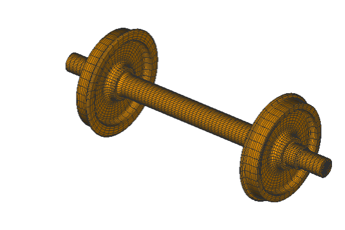
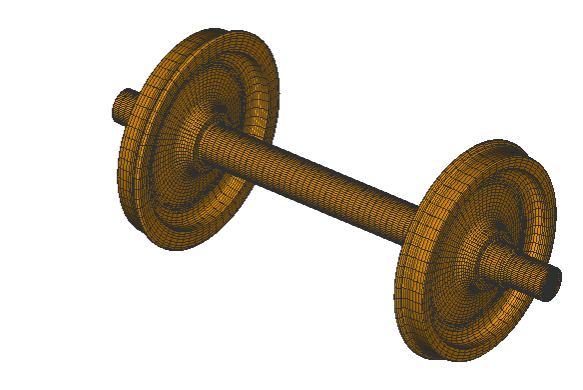
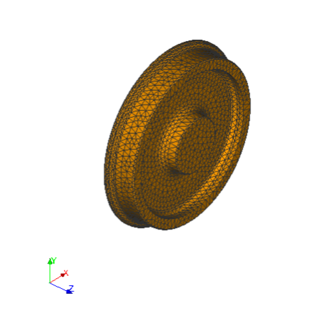
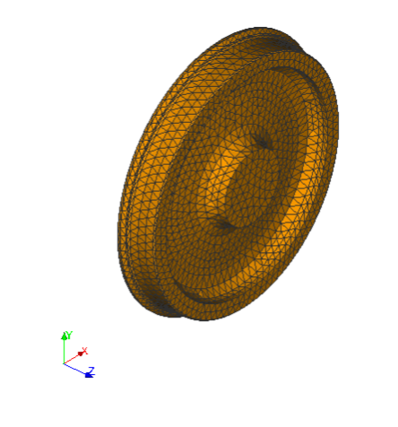

## 5.1 Overview

The Wheelset FE module calculates the frequency response of a 3D railway wheelset under a **unit force applied separately in the vertical and lateral directions** at the wheel–rail contact. The main outputs are:

- **Driving-point FRFs** at the wheel–rail contact, used to calculate the wheel–rail interaction;
- **Vibration field over the wheel surface**, used to calculate the acoustic radiation with the Boundary Element Method.

### Assumptions

- The wheelset is modelled under **free boundary conditions**.
- The **rotation of the wheels is not taken into account**.

The calculation is carried out in two main steps:

1. calculation or reuse of the wheelset vibration modes;
2. calculation of the harmonic response for predefined wheel–rail contact positions.

The graphical interface is divided into three tabs:

- **General**
- **Modes and properties**
- **Execution**

## 5.2 General

The **General** tab defines the simulation name, the output location, and whether the wheelset modes are calculated or reused from a previous simulation.

**1 — Simulation name**  

Enter a name for the simulation. The name must not contain spaces or path separators (`/` or `\`).

The results are stored in a folder with this name inside the selected output folder.

**2 — Output folder**  

Select the folder where the simulation results will be stored.

**3 — Write MED**  

Select **Write MED** to additionally export the wheel response as MED files for visualization of the wheel surface vibration.

**4 — Compute modes**  

If **Compute modes** is selected, the wheelset modes are calculated.

**5 — Existing modes folder**  
If **Compute modes** is not selected, select an existing `Modes` folder. This allows previously calculated modes to be reused without repeating the modal calculation.

## 5.3 Modes and properties

The **Modes and properties** tab defines the wheelset geometry, material properties and the settings used for the frequency response.

**1 — Wheel geometry**  
Two predefined railway passenger wheels are available. Their geometries are shown below.

  
  

  <b>Wheelset 1 (small) - diameter 750 mm, left; Wheelset 2 (large) - diameter 920 mm, right.</b>

The reference coordinate system used in the FE models is:

- **X**: longitudinal direction (direction of travel);
- **Y**: vertical/radial direction;
- **Z**: lateral/axial direction.

Select **Custom** to use your own wheelset model. For a custom wheelset, select the FE wheel mesh and the corresponding projection mesh.

If an existing `Modes` folder is used, the wheel geometry and material properties are taken from the previous modal calculation and cannot be changed.

> [!NOTE]
> Using a **Custom** wheelset is an advanced option. Contact the developers for further information on how to prepare and configure a custom model.

**2 — Export displacement field for BEM**  
Select this option to export the response over the wheel surface for the subsequent Boundary Element calculation. If it is not selected, only the driving-point FRFs at the selected contact positions are calculated.

The wheel surface response is exported on a dedicated **projection mesh**, which is used as the interface between the finite-element wheel model and the Boundary Element model. The corresponding projection mesh is provided automatically for each predefined wheelset.

  
  

  <b>Projection meshes: Wheelset 1 (small), left; Wheelset 2 (large), right.</b>

**3 — FRF type**  
Select whether the frequency response is calculated as **Displacement**, **Velocity** or **Acceleration**.

**4 — Material properties**  
Define the density, Young's modulus and Poisson's ratio of the wheelset material. These properties are used when calculating the wheelset modes.

**5 — Damping**  
Two damping options are available:

- **Nominal**: the damping ratio is assigned according to the circumferential order of each mode.
- **Constant**: the value specified under **Zeta** is applied to all modes.

**6 — Force position**  
The different force positions are provided to account for variations in the lateral position of the wheel–rail contact as the train moves along the track. Select one or more wheel–rail contact positions on the wheel tread:

- **Nominal**: reference contact position, located **7 cm from the wheel flange**;
- **Offset-in**: located **1 cm inwards** from the nominal position (**towards the inner side of the wheelset**);
- **Offset-out**: located **1 cm outwards** from the nominal position (**towards the outer side of the wheelset**).

A separate simulation is added to the queue for each selected force position.

**7 — Frequency range**  
Set the minimum and maximum frequencies of the calculated frequency response. The modal basis is calculated to **1.5 times the maximum frequency** including the rigid-body motion.

## 5.5 Results

For a simulation called `wheel_study`, the results are stored under:

| Path | Content |
|---|---|
| `wheel_study/Modes/` | Modal basis and natural frequencies |
| `wheel_study/nominal/` | Results for the nominal contact position |
| `wheel_study/offsetIN/` | Results for the inward offset position |
| `wheel_study/offsetOUT/` | Results for the outward offset position |
| `<contact case>/vertical/Outputs/` | Response to vertical excitation |
| `<contact case>/lateral/Outputs/` | Response to lateral excitation |
| `<contact case>/vertical/Messages/` | Code_Aster messages for the vertical calculation |
| `<contact case>/lateral/Messages/` | Code_Aster messages for the lateral calculation |

The main result files are:

| File | Content |
|---|---|
| `FRFcontact_vert.txt` | Driving-point response for vertical excitation |
| `FRFcontact_lat.txt` | Driving-point response for lateral excitation |
| `FRF_vert.txt` | Wheel-surface response for vertical excitation |
| `FRF_lat.txt` | Wheel-surface response for lateral excitation |
| `FRF_vert.med` | Wheel-surface response for visualization |
| `FRF_lat.med` | Wheel-surface response for visualization |
  
The `Modes` folder is created only when the modal basis is calculated. It contains the natural frequencies and the modal basis used for the frequency-response calculation.

A separate folder is created for each selected force position: `nominal`, `offsetIN` and `offsetOUT`. Each case contains the responses to **vertical** and **lateral** excitation.

`FRFcontact_vert.txt` and `FRFcontact_lat.txt` contain the driving-point frequency responses at the wheel–rail contact position.

If **Export displacement field for BEM** is selected, `FRF_vert.txt` and `FRF_lat.txt` contain the response over the wheel surface. If **Write MED** is also selected, the corresponding response is additionally written as `FRF_vert.med` and `FRF_lat.med` for visualization of the wheel surface vibration.
