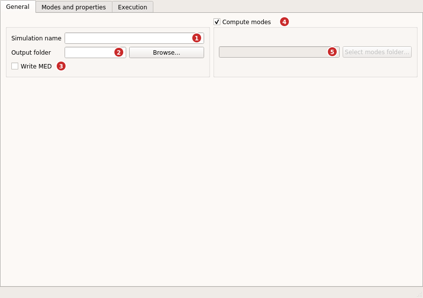
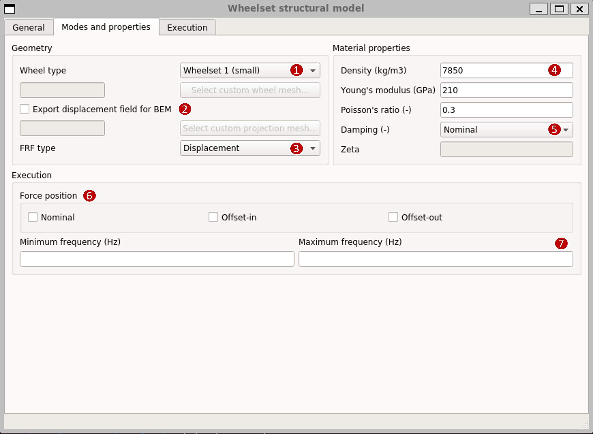

## 5.1 Overview

The Wheelset FE module calculates the **frequency response** of a railway wheelset.

### Assumptions

- The wheelset is modelled under **free boundary conditions**.
- The **rotation of the wheels is not taken into account**.

The calculation is carried out in two main steps:

1. calculation or reuse of the wheelset vibration modes;
2. calculation of the harmonic response for predefined wheel–rail contact positions.

The graphical interface is divided into three tabs:

- **General**
- **Modes and properties**
- **Execution**

The following sections describe these tabs.

## 5.2 General

The **General** tab defines the simulation name, the output location, and whether the wheelset modes are calculated or reused from a previous simulation.

**1 — Simulation name**  

Enter a name for the simulation. The name must not contain spaces or path separators (`/` or `\`).

The results are stored in a folder with this name inside the selected output folder.

**2 — Output folder**  

Select the folder where the simulation results will be stored.

**3 — Write MED**  

Select **Write MED** to additionally export the wheel response as MED files for visualization of the wheel surface vibration.

**4 — Compute modes**  

If **Compute modes** is selected, the wheelset modes are calculated.

**5 — Existing modes folder**  
If **Compute modes** is not selected, select an existing `Modes` folder. This allows previously calculated modes to be reused without repeating the modal calculation.

## 5.3 Modes and properties

The **Modes and properties** tab defines the wheelset geometry, material properties and the settings used for the frequency response.

**1 — Wheel geometry**  
Two predefined railway passenger wheels are available:

- **Wheelset 1 (small)**: wheel diameter **750 mm**;
- **Wheelset 2 (large)**: wheel diameter **920 mm**.

The two predefined wheelset geometries are shown below.

<table>
<tr>
<td align="center" width="50%">

 <b>Wheelset 1 (small)</b>
</td>
<td align="center" width="50%">

 <b>Wheelset 2 (large)</b>
</td>
</tr>
</table>

Select **Custom** to use your own wheelset model. For a custom wheelset, select the FE wheel mesh and the corresponding projection mesh.

If an existing `Modes` folder is used, the wheel geometry and material properties are taken from the previous modal calculation and cannot be changed.

> [!NOTE]
> Using a **Custom** wheelset is an advanced option. Contact the developers for further information on how to prepare and configure a custom model.

**2 — Export displacement field for BEM**  
Select this option to export the response over the wheel surface for the subsequent Boundary Element calculation. If it is not selected, only the driving-point FRFs at the selected contact positions are calculated.

**3 — FRF type**  
Select whether the frequency response is calculated as **Displacement**, **Velocity** or **Acceleration**.

**4 — Material properties**  
Define the density, Young's modulus and Poisson's ratio of the wheelset material. These properties are used when calculating the wheelset modes.

**5 — Damping**  
Two damping options are available:

- **Nominal**: the damping ratio is assigned according to the circumferential order of each mode.
- **Constant**: the value specified under **Zeta** is applied to all modes.

**6 — Force position**  
Select one or more wheel–rail contact positions: **Nominal**, **Offset-in** and **Offset-out**. A separate simulation is added to the queue for each selected position.

**7 — Frequency range**  
Set the minimum and maximum frequencies of the calculated frequency response. An adaptive frequency grid is generated between these limits.

When the wheelset modes are calculated, rigid-body modes are included and the flexible modes are calculated up to **1.5 times the maximum frequency**.
