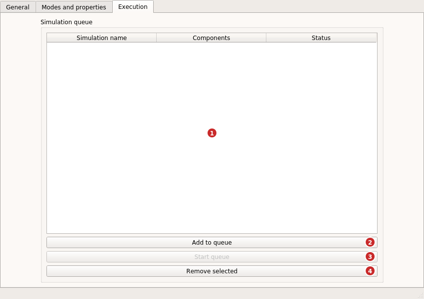

# 5. Wheelset: finite-element model

**Checklist for this chapter**

- [ ] I have opened **Wheelset FE** from the launcher.
- [ ] I have given a simulation name (no spaces, no `/`) and an output folder that exists, inside my home directory.
- [ ] I have chosen to compute the modes, or an existing `Modes` folder.
- [ ] I have chosen the wheelset, the material and the damping.
- [ ] I have ticked at least one force position, and entered the minimum and the maximum frequency.
- [ ] I have chosen the FRF type, and ticked *Export displacement field for BEM* if I will run the Boundary Element module.
- [ ] I have added the simulation to the queue and started the queue.
- [ ] Every row of the queue is *Done*, and the result folders contain the files of section 5.6.

## 5.1 What this module does

The Wheelset FE module computes how a railway **wheelset vibrates when a force is applied at the wheel–rail contact**. It uses a three-dimensional finite-element model of the wheelset, solved with Code_Aster, in two stages:

1. **Modes**: the natural frequencies and mode shapes of the free wheelset.
2. **Harmonic response**: the response to a force of 1 N at the contact, at each frequency, computed by superposing the modes.

For each force position you choose, and for a vertical and a lateral force, it gives:

- the **contact FRFs**: the response at the contact point itself. The Post-processing module uses them to compute the contact force (chapter 7);
- optionally, the **FRFs over the whole surface of the wheel**. The Boundary Element module uses them as the source of the radiated sound (chapter 6).

All results are *per newton of force*.

## 5.2 Open the module

In the launcher, click **Wheelset FE** (chapter 3). A terminal window opens, then the window **Wheel structural model**. It has three tabs: **General**, **Modes and properties** and **Execution**. You fill in the first two, then use the third one to run.

## 5.3 Step 1: the *General* tab


*Figure 5.1 — The General tab.*

1. **Simulation name**: a name for this study, for example `wheel1_study`. It must not contain spaces or `/`. The results are written in a folder with this name.
2. **Output folder**: the folder in which the results are written. Click **Browse…** and choose an existing folder inside your home directory.
3. **Write MED** (optional): tick it to also write the surface FRFs in MED format, which you can open in a post-processing viewer. It has an effect only if *Export displacement field for BEM* is ticked (section 5.4).
4. **Compute modes**: ticked by default, the module computes the modes of the wheelset. Untick it to **reuse the modes of an earlier simulation**; the material and the wheelset are then read from that simulation (section 5.7).
5. **Modes folder** (only when *Compute modes* is unticked): click **Select modes folder…** and choose the folder `Modes` of the earlier simulation.

<!-- TODO(fix pending G3): the output folder must be visible in the container (inside the home directory). -->

## 5.4 Step 2: the *Modes and properties* tab


*Figure 5.2 — The Modes and properties tab.*

**Geometry**

1. **Wheel type**: *Wheelset 1 (small)*, *Wheelset 2 (large)* or *Custom*. The two predefined wheelsets are supplied with the module. For *Custom*, see section 5.8.
2. **Custom wheel mesh**: the finite-element mesh of your own wheelset (only for *Custom*).
3. **Export displacement field for BEM**: tick it if you will run the Boundary Element module (chapter 6). The module then also computes the response over the whole wheel surface, which takes longer. Leave it unticked if you only need the contact FRFs.
4. **Custom projection mesh**: the coarser mesh on which the surface response is written, for the Boundary Element module (only for *Custom*).
5. **FRF type**: the quantity written in the result files: *Displacement* (m/N), *Velocity* ((m/s)/N) or *Acceleration* ((m/s²)/N). Keep **Displacement**, the default: it is the type that all the next modules accept.

<!-- TODO(fix pending B3): the BEM does not read acceleration files with more than one frequency. Re-check this advice when it is fixed. -->

**Material properties** (available when *Compute modes* is ticked)

6. **Density, Young's modulus, Poisson's ratio**: the properties of the wheel steel. The defaults are 7850 kg/m³, 210 GPa and 0.3. The Young's modulus is entered in **GPa**.
7. **Damping**: how the energy loss of each mode is defined.
   - *Nominal*: the module assigns a damping ratio to each mode from its circumferential order *n* (the number of nodal diameters): 0.001 for *n* = 0, 0.01 for *n* = 1, and 0.0001 for *n* ≥ 2.
   - *Constant*: the same damping ratio for all the modes, which you enter in field 8.
8. **Zeta**: the damping ratio of the *Constant* option (for example 0.001). It is disabled for *Nominal*.

**Execution**

9. **Force position**: where the force acts across the running surface of the wheel. Tick at least one:
   - *Nominal*: at the nominal contact point;
   - *Offset-in*: about 15 mm towards the inside of the wheelset (flange side);
   - *Offset-out*: about 15 mm towards the outside.

   One result folder is created for each position you tick (`nominal`, `offsetIN`, `offsetOUT`). Tick all three if you will average over several contact positions in the post-processing.
10. **Minimum frequency (Hz)** and
11. **Maximum frequency (Hz)**: the frequency range of the results. You do not choose a frequency step: the module chooses its own frequencies, close together near the resonances, so that every resonance is well described.

   For the rolling noise, the Post-processing module uses the third-octave bands from 100 Hz to 5 kHz. Choose a range that covers at least these frequencies, with a margin on both sides so that the bands at the edges are complete.

The module also uses the modes up to 1.5 times the maximum frequency, which makes the computation longer when the maximum frequency is high.

<!-- TODO: add typical computation times for the two predefined wheelsets (from the reference case). -->

## 5.5 Step 3: the *Execution* tab, run the calculation



*Figure 5.3 — The Execution tab.*

1. **Simulation queue**: the list of calculations. Each row shows the simulation name and the force position (for example `wheel1_study/nominal`), the *Components* column (the type of contact, for example *Nominal contact*), and the *Status*.
2. **Add to queue**: checks your inputs, then adds **one row for each force position you ticked**.
3. **Start queue**: runs the rows one after the other. The button is available once at least one row has been added.
4. **Remove selected**: removes the selected rows from the queue (before it is started).

To run:

1. Click **Add to queue**. If a message reports a wrong or missing input, correct it and click again. If the result folder of a position already exists, you are asked whether to overwrite it.

   **Expected result**: one row per ticked position, each with the status `Queued`.
2. Click **Start queue**.

   **Expected result**: the status of the first row becomes `Running`. Terminal windows open and close while the calculation goes on: Code_Aster runs in its own terminal for each stage. Do not close them. The status changes to `Done` when the row is finished, and the next row starts.

The first row computes the modes (if *Compute modes* is ticked) and the harmonic response. The next rows reuse these modes and only compute the harmonic response, so they are much faster. While the queue runs, you cannot add or remove rows.

The module uses about 40 % of the processors and 80 % of the RAM of the computer. You do not need to set these.

<!-- TODO(fix pending W1): a calculation that fails inside Code_Aster can still be shown as `Done`. Until it is fixed, always check the result folders (section 5.6). -->
<!-- TODO(fix pending W3): the RAM setting passed to Code_Aster may be too high; check on a real calculation. -->

## 5.6 The results

For a simulation called `wheel1_study`, the output folder contains:

```
wheel1_study/
  Modes/                       the modes, computed once for all the force positions
    fn.txt                       the natural frequencies, in Hz
    modes.med, base_modes/, parameters.json
  nominal/                     one folder for each force position you ticked
    parameters.json              the parameters of the calculation, including the wheel diameter
    nodeCoordinates.txt          the mesh on which the surface response is written
    vertical/                    response to a vertical force
      Outputs/
        FRFcontact_vert.txt        the contact FRF (the response at the contact point)
        FRF_vert.txt               the response over the wheel surface (if you ticked the export for BEM)
      Messages/message_Stage2.mess   the Code_Aster log
    lateral/                     response to a lateral force, with FRFcontact_lat.txt and FRF_lat.txt
  offsetIN/   offsetOUT/       the same, for the other positions
```

**How to check a result**

1. In the queue, every row has the status `Done`.
2. The files `Outputs/FRFcontact_vert.txt` and `FRFcontact_lat.txt` exist in the folders `vertical` and `lateral` of every position, and they are not empty.
3. Open `Modes/fn.txt`: it lists the natural frequencies of the wheelset. The first ones are close to zero (the rigid-body motions of the free wheelset).
4. If something is wrong, open the Code_Aster log `vertical/Messages/message_Stage2.mess` of the position. When a calculation fails, the folders `Phase1_Modes` and `Phase2_FRF` are kept in the position folder, with the logs `message_Stage1.mess` and `message_Stage2.mess`. Look for the lines that start with `<F>` or `<S>`: they are Code_Aster errors.

<!-- TODO: expected values of the first natural frequencies and of the FRFs, from the reference case. -->

## 5.7 Reuse the modes, and add a force position later

The modes do not depend on the force position, so you do not need to compute them again to add a position:

1. On the **General** tab, enter the **same simulation name and the same output folder** as the earlier simulation. The new position folder is then created next to the existing ones, and the Boundary Element and Post-processing modules find all the positions together. The folders of the other positions are not touched.
2. Untick **Compute modes**, then click **Select modes folder…** and choose the folder `Modes` of the earlier simulation.
3. The wheelset and the material are filled in from that simulation, and cannot be changed.
4. Tick the new force position only, and run the queue as before.

Use a maximum frequency that is **not higher than the one of the simulation that created the modes**: the modes only extend to 1.5 times that frequency.

<!-- TODO(fix pending W2): the module does not check the frequency range against the modes folder. -->

## 5.8 Use your own wheel mesh (advanced)

Choose **Custom** as the wheel type, and give the two meshes (MED format, in **metres**):

- the **finite-element mesh** of the wheelset, in which the following **groups** must exist:
  - a group of one node for each force position you will tick: `wheel_contact`, `wheel_contact_off2` (offset-in), `wheel_contact_off1` (offset-out);
  - a group `wheel_surface` with the nodes of the surface that radiates sound;
- the **projection mesh** of the radiating wheel surface, with a group `wheel_surface_BE`.

The module reads the wheel radius from the position of the contact node, so the wheel axis must be the **Z axis** and the contact node must be on the **positive Y** side. The ring of nodes around the wheel that passes through the contact node must have at least 41 nodes, because the damping of each mode is determined from it.

<!-- TODO(fix pending W4): this ring requirement applies even when the damping is Constant. -->

## 5.9 What the next modules need from this chapter

- The **Boundary Element** module reads, for each force position, the surface FRFs in `<simulation>/<position>/vertical/Outputs/` and `lateral/Outputs/`, and the file `parameters.json` of the position folder. It needs *Export displacement field for BEM* to have been ticked.
- The **Post-processing** module reads the contact FRFs `FRFcontact_vert.txt` and `FRFcontact_lat.txt` in the same folders.
- The position folders must keep their names `nominal`, `offsetIN` and `offsetOUT`.
- Go on with [chapter 6](06-bem.md), or with [chapter 4](04-track.md) if you have not computed the track yet.
