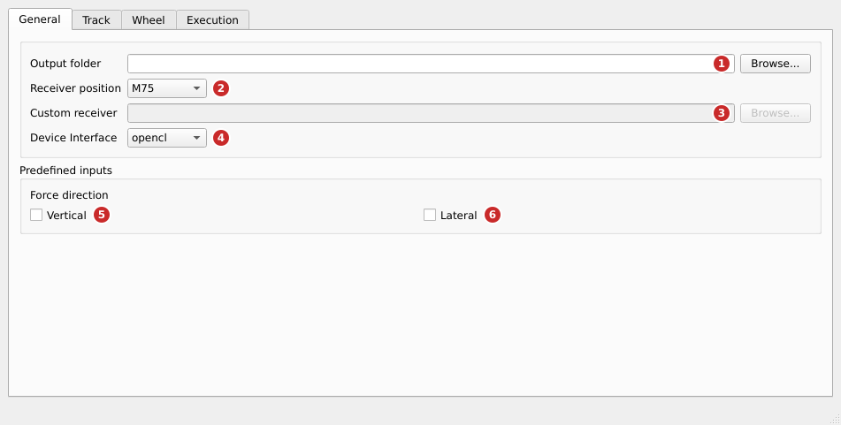
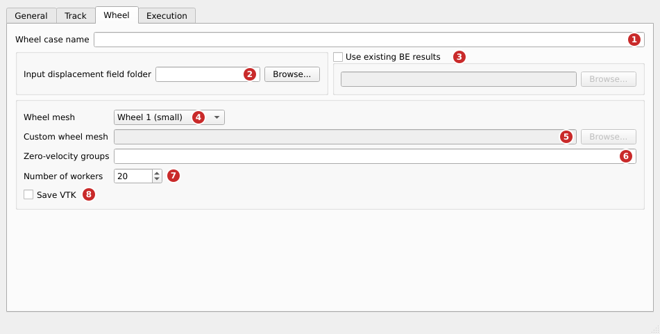

# 6. Radiation: Boundary Element

**Checklist for this chapter**

- [ ] I have the results of the track (chapter 4) and of the wheelset (chapter 5), with the surface displacement fields, in folders named as described in section 6.2.
- [ ] I have opened **Boundary Element** from the launcher.
- [ ] On the **General** tab: I have chosen the output folder, the receivers and the force directions.
- [ ] On the **Track** and **Wheel** tabs: I have named the cases and chosen the folders of the structural results.
- [ ] I have lowered the numbers of calculation processes if my computer is not a large workstation.
- [ ] On the **Execution** tab: I have chosen the components, added the calculations to the queue, and started the queue.
- [ ] Every row of the queue is *Done*, and the result folders contain the files of section 6.7.

## 6.1 What this module does

The Boundary Element (BEM) module computes the **sound radiated by the vibrating rail, sleepers and wheel**. It takes the vibration of their surfaces, computed by the Multi-Sleeper Model and the Wheelset FE module, and it computes the sound pressure that this vibration produces at receivers placed beside the track.

Each component is computed on its own, for each contact position and for each force direction (vertical, lateral). The results are *per newton of contact force*: they are **acoustic transfer functions**, in pascals per newton. The Post-processing module (chapter 7) multiplies them by the real contact force.

The model has these properties, which you should keep in mind when you read the results:

- the sound radiates in **free field**: there is no ground, no ballast reflection and no shielding;
- the rail, the sleepers and the wheel radiate **independently**: they do not scatter each other's sound;
- only **one rail and one wheel** are modelled;
- the rail is modelled as a chain of identical segments (by default 15 segments of 3.6 m, so 54 m), and the sleepers as blocks of 5 sleepers (by default 9 blocks, so 45 sleepers); each segment is solved alone, and their sound pressures are added;
- the air has a speed of sound of 343 m/s and a density of 1.21 kg/m³.

## 6.2 What you need before you start

**Track results** (from the Multi-Sleeper Model, chapter 4), one folder for each contact case:

- its name must **end with** one of: `midSpan_`, `quarterSpan_` or `onSleeper_`, followed by `nominal`, `offsetIN` or `offsetOUT` (for example `study_midSpan_nominal`);
- it must contain the folders `vert` and `lat`, each with a folder `Outputs` and a file `parameters.json`;
- the rail and the sleeper displacement fields must have been written. The track results must cover the length that the BEM models (54 m of rail and 27 m of sleepers by default).

<!-- TODO(fix pending B5): the module does not check that the structural results cover the length of the acoustic model. -->

**Wheel results** (from the Wheelset FE module, chapter 5), one folder for each force position:

- its name must **end with** `nominal`, `offsetIN` or `offsetOUT`;
- it must contain the folders `vertical` and `lateral`, each with a folder `Outputs` and a file `parameters.json`;
- *Export displacement field for BEM* must have been ticked.

**Free RAM.** Several calculation processes run at the same time and each one holds large matrices in RAM. Read the section on the number of processes (6.4) before you start.

## 6.3 Step 1: the *General* tab



*Figure 6.1 — The General tab.*

1. **Output folder**: the folder in which the results are written. Click **Browse…** and choose an existing folder inside your home directory.
2. **Receiver position**: where the sound pressure is computed.
   - *M75*: 7.5 m from the track centre line, 1.2 m above the rail head.
   - *M3*: 3 m from the track centre line, 1.2 m above the rail head.
   - *Custom*: positions from a file (field 3).

   For *M75* and *M3*, the module computes the pressure on **a line of 501 receivers along the track, from −25 m to +25 m every 0.1 m**, centred on the model.
3. **Custom receiver**: a file in `.xlsx` or `.csv` format, **without header**, with exactly three columns, one row for each receiver: the distance to the track centre line (m), the height above the rail head (m), and the position along the track (m), counted from the centre of the model.
4. **Device Interface**: the program that executes the heavy calculations. Keep *opencl*. If a calculation stops at start with an error about OpenCL, choose *numba*.
5. **Vertical** and
6. **Lateral**: the force directions to compute. Tick at least one. The Post-processing module needs **both** directions.

> **If you want to use the pass-by of the Post-processing module**, keep *M75* or *M3*: the pass-by needs the line of 501 receivers.

<!-- TODO(fix pending P3): custom receivers cannot be used for the pass-by of the Post-processing module. -->

## 6.4 Step 2: the *Track* tab


*Figure 6.2 — The Track tab.*

1. **Track case name**: a name for this study, for example `track_study`. It must not contain `/`. Use the **same name for all the contact cases** of the study: the results are then grouped in one folder.
2. **Input displacement field folder**: click **Browse…** and choose the folder of one contact case of the Multi-Sleeper Model (section 6.2). The module reads its `parameters.json`, selects the matching rail and sleeper meshes, and then **locks** the mesh menus (fields 4 and 10).
3. **Use existing BE results**: tick it to compute only the pressure at **new receivers**, from the results of an earlier calculation, without solving the problem again. Choose the **contact folder** of the earlier results (for example `track_study/midSpan_nominal`). The results are written under the new case name; it must be different from the earlier one.

**Rail**

4. **Rail mesh**: *60E2*, *54E2* or *Custom*. It is set from the track results.
5. **Custom rail mesh**: your own mesh (section 6.9).
6. **Number of rail substructures**: the number of rail segments of 3.6 m, an **odd** number. The default is 15, which models 54 m of rail. A larger number models a longer rail and takes longer.
7. **Number of workers (rail)**: the number of segments solved at the same time. The default is 15 and suits a large workstation; **lower it on a laptop**. Start with a small number, for example 2 or 4, watch the RAM use of your computer with a system monitor during the first calculation, and increase the number if there is room.
8. **Zero-velocity groups**: names of mesh groups, separated by commas, on which the vibration is set to zero so that they do not radiate. Leave it empty if you do not need it.
9. **Save VTK**: also write the vibration field on the mesh, to look at it in a viewer such as ParaView.

<!-- TODO(fix pending B4): ask the developers whether the rail cut faces (group `cross_section`) should be listed by default. -->

**Sleepers**

10. **Sleeper mesh**: *B91-60E2*, *B91-54E2* or *Custom*. It follows the rail type.
11. **Custom sleeper mesh**: your own mesh (section 6.9).
12. **Rail height [m]**: used to place the receivers above the sleepers. It is filled in from the rail type (0.172 m for the 60E2 rail) and can be changed only with a custom mesh.
13. **Number of sleeper substructures**: the number of blocks of 5 sleepers, an **odd** number. The default is 9, which models 45 sleepers.
14. **Number of workers (sleepers)**: as field 7. The default is 9.
15. **Zero-velocity groups**: the default is `bottom`, the underside of the sleepers, which lies in the ballast and should not radiate.
16. **Save VTK**.

> **How many workers?** Each worker holds the dense matrices of one segment in RAM. The defaults (15 workers for the rail, 9 for the sleepers, 20 for the wheel) are meant for a computer with many cores and a lot of RAM. If your computer becomes unresponsive or a calculation is killed, lower the numbers.

<!-- TODO: give the memory used by one worker, measured on a real calculation, and a rule to choose the number of workers. -->
<!-- TODO(fix pending B7): the defaults are those of a server. -->

## 6.5 Step 3: the *Wheel* tab



*Figure 6.3 — The Wheel tab.*

1. **Wheel case name**: a name for this study, for example `wheel_study`. Use the same name for all the force positions.
2. **Input displacement field folder**: click **Browse…** and choose the folder of **one force position** of the Wheelset FE module (`nominal`, `offsetIN` or `offsetOUT`, section 6.2). The module reads its `parameters.json`, selects the matching wheel mesh and the wheel diameter, and locks the mesh menu.
3. **Use existing BE results**: as for the track (section 6.4, field 3).
4. **Wheel mesh**: *Wheel 1 (small)*, *Wheel 2 (large)* or *Custom*.
5. **Custom wheel mesh**: your own mesh (section 6.9).
6. **Zero-velocity groups**: as for the track. The predefined wheel meshes have no groups.
7. **Number of workers**: the number of frequencies solved at the same time. The default is 20; lower it on a laptop.
8. **Save VTK**.

## 6.6 Step 4: the *Execution* tab, run the calculations


*Figure 6.4 — The Execution tab.*

1. **Wheel**,
2. **Rail** and
3. **Sleepers**: three buttons that you switch on or off. They choose **which components the next *Add to queue* adds**. Switch on at least one. *Rail* and *Sleepers* use the Track tab; *Wheel* uses the Wheel tab.
4. **Progress**: a message when each row starts and ends, and the last lines of the log when a row fails. The detailed messages of the calculation appear in the terminal window of the module.
5. **Simulation queue**: the list of calculations. Each row shows the case name, the component with the contact case and the direction (for example `Rail / midSpan_nominal / vertical`), and the *Status*.
6. **Add to queue**: checks your inputs, then adds **one row for each component and each direction** that you chose.
7. **Start queue**: runs the rows one after the other.
8. **Remove selected**: removes the selected row.

**To compute one contact case of the track:**

1. Fill in the **General** tab and the **Track** tab.
2. On the **Execution** tab, switch on **Rail** and **Sleepers**, and switch off **Wheel**.
3. Click **Add to queue**.

   **Expected result**: four rows with the status `Queued` if both force directions are ticked on the General tab: the rail and the sleepers, each for the vertical and the lateral direction.
4. For the next contact case, go back to the **Track** tab, choose the next folder in field 2 (keeping the same case name), and click **Add to queue** again.

**To compute one force position of the wheel:** fill in the **Wheel** tab, switch on **Wheel** only, and click **Add to queue**. You get two rows, one for each direction (if both are ticked). Repeat with the next force position.

> **The number of calculations adds up.** A complete study with the 9 contact cases of the track and the 3 force positions of the wheel needs 9 × 4 + 3 × 2 = **42 calculations**. Start with one contact case to see how long it takes.

When all rows are in the queue, click **Start queue**.

**Expected result**: the status of the first row becomes `Running`, then `Done`, and the next row starts. The *Progress* area shows when each row starts and ends, and the terminal window of the module shows the messages of the calculation. The rows are run one at a time; each row uses several processes (the workers).

If a result folder already exists, you are asked to confirm that it may be overwritten. The old results are **deleted when that row starts**, not when you add it. If a row ends with the status `Failed`, the *Progress* area shows the last lines of its log, and the folder of the row contains the files `log.txt` and `error_message.txt`.

<!-- TODO(fix pending G2, B8): the module needs the ToPNoise folder and a `runtime` folder to start; check that the launcher provides them. -->
<!-- TODO: typical computation times of one row (from the reference case). -->

## 6.7 The results

For a track case called `track_study`, each row writes its results in its own folder:

```
track_study/
  midSpan_nominal/                    one folder for each contact case
    Rail/
      vertical/
        acouRes_rail_vertical.h5        the sound pressure at the receivers, the radiated power
        bemData_rail_vertical.h5        the solution on the surface (to recompute at other receivers)
        parameters_rail_vertical.json   the parameters of the calculation
        log.txt                         the messages of the calculation
      lateral/                          the same files, for a lateral force
    Sleepers/
      vertical/   lateral/              the same files, for the sleepers
  midSpan_offsetIN/  ...
wheel_study/
  nominal/                            one folder for each force position
    vertical/
      acouRes_wheel_vertical.h5  bemData_wheel_vertical.h5  parameters_wheel_vertical.json  log.txt
    lateral/
  offsetIN/  offsetOUT/
```

The two `.h5` files are in HDF5 format. You can look at them with an HDF5 viewer (for example HDFView), or with Python and the `h5py` package. The main contents of `acouRes_*.h5` are:

| Name | Content | Unit |
|---|---|---|
| `frequencies` | the frequencies | Hz |
| `receiver_positions` | the positions of the receivers | m |
| `pressure` | the sound pressure at each receiver and frequency (complex) | Pa per N of force |
| `power` | the radiated sound power | W per N² |
| `mean_square_velocity`, `radiation_efficiency` | mean square velocity of the surface, and the radiation efficiency | — |

The folder names (`midSpan_nominal`, `nominal`…) and the file names are used by the Post-processing module to find the results: do not rename them.

**How to check a result**

1. Every row of the queue has the status `Done`.
2. The folders `vertical` and `lateral` of every component contain `acouRes_….h5` and `bemData_….h5`.
3. The last lines of `log.txt` report that the files were saved.

<!-- TODO: expected levels of the pressure for the reference case. -->
<!-- TODO(fix pending B1): describe the time convention of the pressures once it is decided. -->

## 6.8 Recompute at other receivers

To get the pressure at other receivers without solving again:

1. Choose the new receivers on the **General** tab.
2. On the **Track** (or **Wheel**) tab, tick **Use existing BE results** and choose the contact folder of the earlier results.
3. Give a **new case name**, then add to the queue and run as before.

The new folders contain only `acouRes_….h5`: the file `bemData_….h5` is not copied. The sound power calculation of the Post-processing module needs `bemData_….h5` next to `acouRes_….h5`, so copy it from the earlier folder if you need the power.

## 6.9 Use your own meshes (advanced)

The acoustic meshes are surface meshes of triangles in **Gmsh `.msh` format**, in **metres**. The axes are: *x* along the track, *y* upwards, *z* across the track.

- **Rail**: one segment, about 3.6 m long along *x*, with its axis on *z* = 0 and its foot at *y* = 0. It must have a group named `rail` (the group that is tilted by the rail inclination, 1:40 by default). The two end faces can be put in a group (`cross_section` in the supplied meshes).
- **Sleepers**: a block of 5 sleepers along *x*, centred on the track centre line (*z* = 0), with the underside at *y* = 0. The supplied meshes have the groups `boundary`, `top_surface` and `bottom`.
- **Wheel**: the wheel centred at *x* = 0 and *y* = 0, its axle along *z*, at the lateral position of the wheel in the track (about *z* = +0.75 m), and with the contact point on the *+y* side, as in the finite-element model.

<!-- TODO(fix pending B6): check the orientation convention of the wheel mesh with the developers. -->

## 6.10 What the next modules need from this chapter

- The **Post-processing** module reads, for each component and each contact case, both directions: `acouRes_….h5` in the folders `vertical` and `lateral`. Choose the **case folders** (`track_study`, `wheel_study`) in its *BEM results* fields.
- The calculation of the sound power in the Post-processing also needs the file `bemData_….h5` next to each `acouRes_….h5`.
- Keep the default receivers (*M75* or *M3*) if you will compute the pass-by.
- Go on with [chapter 7](07-postprocessing.md).
