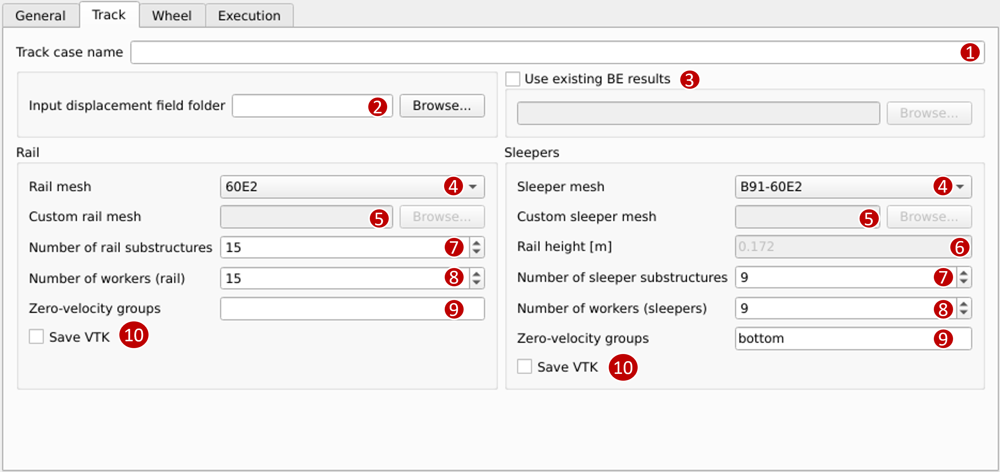

## 6.1 Overview

The Boundary Elements Method (BEM) module calculates the acoustic radiation of the **rail, sleepers and wheel** from the vibration fields calculated with the FE models. Similar to the structural models, the acoustic calculation is carried out separately using the vibration fields obtained for **vertical and lateral unit forces**.

The main outputs **per component** are:

- **Acoustic pressure per unit force** at the defined receiver positions **[Pa/N]**;
- **Radiated sound power per squared unit force** **[W/N²]**;
- **Radiation efficiency**;
- **Boundary solution** on the vibrating surface (boundary normal velocity and pressure), which can be reused to calculate the acoustic pressure at different receiver positions without repeating the BEM solution.

### Assumptions

- The acoustic radiation is calculated in **free field**. Propagation effects from the ground and ballast are not taken into account.
- The **rail, sleepers and wheel are treated as independent acoustic radiators**.
- The acoustic model includes **one rail and one wheel** only.

The structural vibration field is first transferred from the FE surface mesh to the corresponding BE mesh. The normal surface velocity is then used as boundary condition for the acoustic calculation. The resulting surface pressure is used to calculate the radiated sound power and the acoustic pressure at the receiver positions.

Internally, the calculation is therefore carried out in two main steps:

1. calculation of the BEM boundary solution from the structural vibration field;
2. calculation of the acoustic field at the selected receiver positions.

If an existing BEM boundary solution is used, only the second step is repeated.

The graphical interface is divided into four tabs:

- **General**
- **Track**
- **Wheel**
- **Execution**

## 6.2 General

The **General** tab defines the output location, receiver positions, computational backend and force directions used for the acoustic calculations.

**1 — Output folder**  

Select the folder where the BEM results will be stored.

**2 — Receiver position**  

Select the receiver positions where the acoustic pressure is calculated. Two predefined measurement positions are available:

- **M75**: 7.5 m from the track centreline and 1.2 m above the rail head;
- **M3**: 3 m from the track centreline and 1.2 m above the rail head.

> [!NOTE]
> For both predefined positions, the receivers are distributed along a line parallel to the track from **−25 m to +25 m**, with a spacing of **0.1 m**. This array of receivers is used later to reconstruct the single-axle pass-by.

Select **Custom** to define other receiver positions.

**3 — Custom receiver**  

For custom receivers, select a `.csv` or `.xlsx` file without a header. Each row defines one receiver using three columns:

1. lateral distance from the track centreline [m];
2. height above the rail head [m];
3. longitudinal position relative to the centre of the model [m].

**4 — Device Interface**  

Select the computational backend used for the BEM calculation:

- **opencl** (recommended for faster computations);
- **numba**.

**5–6 — Force direction**  

Select whether the acoustic response is calculated from the structural response to the **vertical**, **lateral**, or both unit forces. The two directions are calculated separately.

## 6.3 Track

The **Track** tab defines the input structural response and the BE calculation settings for the **rail and sleepers**.

**1 — Track case name**  

Enter a name for the track acoustic simulation. A folder with this name is created in which the BE results are stored.

**2 — Input displacement field folder**  

Select the folder corresponding to one contact case calculated with the Multi-Sleeper Model.

The rail and sleeper types are read automatically from the structural simulation parameters and the corresponding predefined BE meshes are selected.

The selected folder must correspond to one of the following contact cases:

- `midSpan_nominal`
- `midSpan_offsetIN`
- `midSpan_offsetOUT`
- `quarterSpan_nominal`
- `quarterSpan_offsetIN`
- `quarterSpan_offsetOUT`
- `onSleeper_nominal`
- `onSleeper_offsetIN`
- `onSleeper_offsetOUT`

**3 — Use existing BE results**  

Select this option to reuse an existing BE boundary solution and calculate the acoustic pressure at different receiver positions without repeating the first step of the BE solution.

Select the folder corresponding to the previously calculated track contact case. The existing boundary solutions of the rail and/or sleepers are then used depending on the components selected for execution. Only the acoustic field at the new receiver positions is recalculated.

**4 — BE mesh**  

Select the BE mesh used for the rail and sleepers. Predefined meshes are available for **UIC 60E2**, **UIC 54E2** rail profiles and their corresponding **B91 sleeper** mesh.

When an input displacement field folder is selected, the rail and sleeper types are read from the structural simulation and the corresponding BE meshes are selected automatically.

Select **Custom** to use another rail BEM mesh.

**5 — Custom BE mesh**  

Select **Custom** to use another rail and/or sleeper BEM mesh and specify the corresponding `.msh` file.

> [!NOTE]
> Using a **Custom** BE mesh is an advanced option. Contact the developers for further information on setting up a new mesh.

**6 — Rail height**  

Define the rail height used to position the sleeper receiver points relative to the rail head.

For the predefined rail meshes, the value is assigned automatically:

- **60E2**: 0.172 m;
- **54E2**: 0.161 m.

**7 — Number of substructures**  

The number of substructures determines the total length of the rail and sleepers section included in the acoustic calculation. To simulate the acoustic radiation of a given rail and/or sleeper section, a substructuring approach is used. A reference substructure mesh is defined for both the rail and sleepers, as shown below.. This reference substructure is duplicated to the left and right along the longitudinal direction of the track until the required length is reached.

  
  

  <b>UIC 60E2 rail cell (3.6 meters), left; B91-60E2 sleepers cell (5 sleepers), right.</b>

The surface velocity field obtained from the FE models is projected onto each substructure, and the BE problem is solved separately for each one. The total acoustic pressure at the receiver positions is then obtained by summing the complex pressure contributions from all substructures.

The total number of substructures is defined by the user. For example, for a UIC 60E2 rail profile, a 54 m rail section can be simulated using **15 substructures**.
The required number of substructures depends on the spatial extent of the structural vibration field obtained from the FE models and on its contribution to the acoustic pressure at the receiver positions. It can be determined through a convergence study by progressively increasing the number of substructures and comparing the resulting acoustic pressure spectra. Increasing the number of substructures also increases the computation time.

> [!NOTE]
> The number of substructures must be an **odd number** so that the acoustic model remains centred around the reference substructure.

**8 — Number of workers**  

The BE problem is solved separately for each substructure, allowing the calculations to be parallelized and reducing the overall computation time. The number of substructure calculations performed simultaneously is controlled by the **number of workers**. Increasing the number of workers can reduce the calculation time, provided that sufficient CPU cores are available.

> [!NOTE]
> The number of workers should be selected according to the available computational resources. As a rule of thumb, at least **three to four CPU cores per worker** should be available. It is also recommended to choose the number of workers as an integer divisor of the total number of available CPU cores.

**8 — Zero-velocity groups**  

Optionally specify physical groups of the BEM mesh for which the normal surface velocity is set to zero. Multiple group names can be entered separated by commas.

Leave this field empty if no part of the mesh should be excluded from the acoustic radiation.

**9 — Save VTK**  

Select this option to export the interpolated vibration field on the complete rail BEM mesh in VTK format for visualization.

### Sleepers

**10 — Sleeper mesh**  

Select the BEM mesh used for the sleepers. Predefined meshes are available for the **B91 sleeper** combined with the 60E2 and 54E2 rail types.

The sleeper mesh is selected automatically from the structural simulation together with the corresponding rail type.

Select **Custom** to use another sleeper BEM mesh.

**11 — Custom sleeper mesh**  

Select the `.msh` file containing the custom sleeper BEM mesh.

**12 — Rail height**  

Defines the rail height used to position the receiver points relative to the rail head.

For the predefined rail meshes, the value is assigned automatically:

- **60E2**: 0.172 m;
- **54E2**: 0.161 m.

The value can be modified when a custom rail mesh is used.

**13 — Number of sleeper substructures**  

Define the number of sleeper substructures used in the acoustic model. Each sleeper substructure contains **five sleepers**, and the substructures are repeated along the longitudinal direction.

The number of substructures must be an **odd number**.

The default value is **9 substructures**, corresponding to **45 sleepers**.

**14 — Number of workers (sleepers)**  

Define the maximum number of sleeper substructures calculated simultaneously.

As for the rail, increasing the number of workers can reduce the calculation time at the cost of higher computational resource usage.

**15 — Zero-velocity groups**  

Specify physical groups of the sleeper BEM mesh for which the normal surface velocity is set to zero.

For the predefined sleeper meshes, the default group is `bottom`, corresponding to the bottom surface of the sleepers.

**16 — Save VTK**  

Select this option to export the interpolated vibration field on the complete sleeper BEM mesh in VTK format for visualization.
