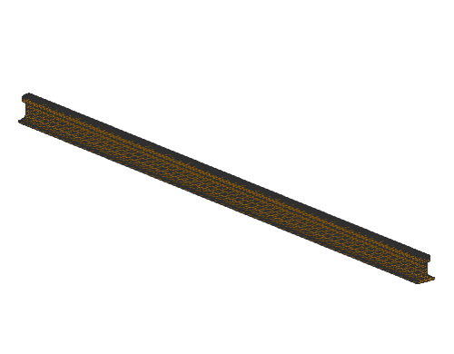
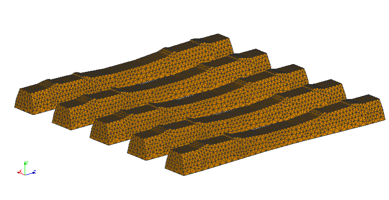
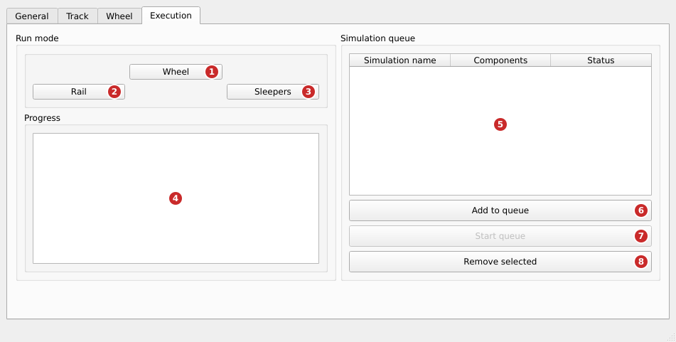

## 6.1 Overview

The Boundary Elements Method (BEM) module calculates the acoustic radiation of the **rail, sleepers and wheel** from the vibration fields calculated with the FE models. Similar to the structural models, the acoustic calculation is carried out separately using the vibration fields obtained for **vertical and lateral unit forces**.

The main outputs **per component** are:

- **Acoustic pressure per unit force** at the defined receiver positions **[Pa/N]**;
- **Radiated sound power per squared unit force** **[W/N²]**;
- **Radiation efficiency**;
- **Boundary solution** on the vibrating surface (**boundary normal velocity** and **pressure**), which can be reused to calculate the acoustic pressure at different receiver positions without repeating the BE solution.

### Assumptions

- The acoustic radiation is calculated in **free field**. Propagation effects from the ground and ballast are not taken into account.
- The **rail, sleepers and wheel are treated as independent acoustic radiators**.
- The acoustic model includes **one rail and one wheel** only.

The structural vibration field is first transferred from the FE surface mesh to the corresponding BE mesh. The normal surface velocity is then used as boundary condition for the acoustic calculation. The resulting surface pressure is used to calculate the radiated sound power and the acoustic pressure at the receiver positions.

Internally, the calculation is therefore carried out in two main steps:

1. calculation of the BE boundary solution from the structural vibration field;
2. calculation of the acoustic field at the selected receiver positions.

If an existing BE boundary solution is used, only the second step is repeated.

The graphical interface is divided into four tabs:

- **General**
- **Track**
- **Wheel**
- **Execution**

## 6.2 General

The **General** tab defines the output location, receiver positions, computational backend and force directions used for the acoustic calculations.

**1 — Output folder**  

Select the folder where the BE results will be stored.

**2 — Receiver position**  

Select the receiver positions where the acoustic pressure is calculated. Two predefined measurement positions are available:

- **M75**: 7.5 m from the track centreline and 1.2 m above the rail head;
- **M3**: 3 m from the track centreline and 1.2 m above the rail head.

> [!NOTE]
> For both predefined positions, an array of receivers distributed along a line parallel to the track from **−25 m to +25 m**, with a spacing of **0.1 m** is created. These receivers are used later to reconstruct the single-axle pass-by.

Select **Custom** to define other receiver positions.

**3 — Custom receiver**  

For custom receivers, select a `.csv` or `.xlsx` file without a header. Each row defines one receiver using three columns:

1. lateral distance from the track centreline [m];
2. height above the rail head [m];
3. longitudinal position relative to the centre of the model [m].

**4 — Device Interface**  

Select the computational backend used for the BE calculation:

- **opencl** (recommended for faster computations);
- **numba**.

**5 — Force direction**  

Select the force directions to be considered in the acoustic calculation: **vertical**, **lateral**, or both. The acoustic response is calculated separately for each direction.

> [!NOTE]
> Running both directions is necessary for the full rolling noise prediction workflow.

## 6.3 Track

The **Track** tab defines the input structural response and the BE calculation settings for the **rail and sleepers**.

**1 — Track case name**  

Enter a name for the track acoustic simulation. A folder with this name is created in which the BE results are stored.

**2 — Input displacement field folder**  

Select the folder corresponding to one contact case calculated with the Multi-Sleeper Model.

The rail and sleeper types are read automatically from the structural simulation parameters and the corresponding predefined BE meshes are selected.

The selected folder must correspond to one of the following contact cases:

- `midSpan_nominal`
- `midSpan_offsetIN`
- `midSpan_offsetOUT`
- `quarterSpan_nominal`
- `quarterSpan_offsetIN`
- `quarterSpan_offsetOUT`
- `onSleeper_nominal`
- `onSleeper_offsetIN`
- `onSleeper_offsetOUT`

**3 — Use existing BE results**  

Select this option to reuse an existing BE boundary solution and calculate the acoustic pressure at different receiver positions without repeating the first step of the BE solution.

Select the folder corresponding to the previously calculated track contact case. The existing boundary solutions of the rail and/or sleepers are then used depending on the components selected for execution. Only the acoustic field at the new receiver positions is recalculated.

**4 — BE mesh**  

Select the BE mesh used for the rail and sleepers. Predefined meshes are available for **UIC 60E2**, **UIC 54E2** rail profiles and their corresponding **B91 sleeper** mesh.

When an input displacement field folder is selected, the rail and sleeper types are read from the structural simulation and the corresponding BE meshes are selected automatically.

**5 — Custom BE mesh**  

Select **Custom** to use another rail and/or sleeper BE mesh and specify the corresponding `.msh` file.

> [!NOTE]
> Using a **Custom** BE mesh is an advanced option. Contact the developers for further information on setting up a new mesh.

**6 — Rail height**  

Define the rail height used to position the sleeper receiver points relative to the rail head.

For the predefined rail meshes, the value is assigned automatically:

- **60E2**: 0.172 m;
- **54E2**: 0.161 m.

**7 — Number of substructures**  

The number of substructures determines the total length of the rail and sleepers section included in the acoustic calculation. To simulate the acoustic radiation of a given rail and/or sleeper section, a substructuring approach is used. A reference substructure mesh is defined for both the rail and sleepers, as shown below. This reference substructure is duplicated to the left and right along the longitudinal direction of the track until the required length is reached.

  
  

  <b>UIC 60E2 rail substructure (3.6 m), left; B91-60E2 sleeper substructure (5 sleepers), right.</b>

The surface velocity field obtained from the FE models is projected onto each substructure, and the BE problem is solved separately for each one. The total acoustic pressure at the receiver positions is then obtained by summing the complex pressure contributions from all substructures.

The total number of substructures is defined by the user. For example, for a UIC 60E2 rail profile, a 54 m rail section can be simulated using **15 substructures**.
The required number of substructures depends on the spatial extent of the structural vibration field obtained from the FE models and on its contribution to the acoustic pressure at the receiver positions. It can be determined through a convergence study by progressively increasing the number of substructures and comparing the resulting acoustic pressure spectra. Increasing the number of substructures also increases the computation time.

> [!NOTE]
> The number of substructures must be an **odd number** so that the acoustic model remains centred around the reference substructure.

**8 — Number of workers**  

The BE problem is solved separately for each substructure, allowing the calculations to be parallelized and reducing the overall computation time. The number of substructure calculations performed simultaneously is controlled by the **number of workers**. Increasing the number of workers can reduce the calculation time, provided that sufficient CPU cores are available.

> [!NOTE]
> The number of workers should be selected according to the available computational resources. As a rule of thumb, at least **3 to 4 CPU cores per worker** should be available. It is also recommended to choose the number of workers as an **integer divisor of the total number of available CPU cores**.

**9 — Zero-velocity groups**  

Specify physical groups of the BE mesh for which the normal surface velocity is set to zero. Multiple group names can be entered separated by commas.

The sleepers are embedded within the ballast and their bottom surface does not radiate. For the predefined sleeper meshes the default group is `bottom`, corresponding to the bottom surface of the sleepers, for which the velocity field is set to zero.

Leave the field empty if no surface should be excluded from the acoustic radiation.

**10 — Save VTK**  

Select this option to export the interpolated vibration field on the complete BE mesh in VTK format for visualization (with ParaView for example).

## 6.4 Wheel

The **Wheel** tab defines the input structural response and the BE calculation settings for the **wheel**.

**1 — Wheel case name**  

Enter a name for the wheel acoustic simulation. A folder with this name is created in which the BE results are stored.

**2 — Input displacement field folder**  

Select the folder corresponding to one contact position calculated with the Wheelset FE model.

The wheel type is read automatically from the structural simulation parameters and the corresponding predefined BE mesh is selected.

The selected folder must correspond to one of the following contact positions:

- `nominal`
- `offsetIN`
- `offsetOUT`

**3 — Use existing BE results**  

Select this option to reuse an existing BE boundary solution and calculate the acoustic pressure at different receiver positions without repeating the first step of the BE solution.

Select the folder corresponding to the previously calculated wheel contact position. Only the acoustic field at the new receiver positions is recalculated.

**4 — BE mesh**  

Select the BE mesh used for the wheel. Predefined meshes are available for:

- **Wheel 1 (small)**
- **Wheel 2 (large)**

When an input displacement field folder is selected, the wheel type is read from the structural simulation and the corresponding BE mesh is selected automatically.

**5 — Custom BE mesh**  

Select **Custom** to use another wheel BE mesh and specify the corresponding `.msh` file.

> [!NOTE]
> Using a **Custom** BE mesh is an advanced option. Contact the developers for further information on setting up a new mesh.

**6 — Zero-velocity groups**  

Specify physical groups of the BE mesh for which the normal surface velocity is set to zero. Multiple group names can be entered separated by commas.

Leave the field empty if no surface should be excluded from the acoustic radiation.

**7 — Number of workers**  

The BE calculations for the wheel are executed in parallel for different frequencies. The number of frequency calculations performed simultaneously is controlled by the **number of workers**.

Increasing the number of workers can reduce the calculation time, provided that sufficient CPU cores are available.

> [!NOTE]
> It is recommended to use at least **3 to 4 CPU cores per worker** and to choose the number of workers as an **integer divisor of the total number of available CPU cores**.

**8 — Save VTK**  

Select this option to export the interpolated vibration field on the wheel BE mesh in VTK format for visualization (with ParaView for example).

## 6.5 Execution

The **Execution** tab defines the components to be calculated and manages the simulation queue.

**1–3 — Components**  

Select the components to be included in the calculation:

- **Wheel**
- **Rail**
- **Sleepers**

One or more components can be selected simultaneously.

**4 — Progress**  

Displays the progress of the simulation queue and reports when a calculation starts, finishes or fails.

**5 — Simulation queue**  

Shows the simulations added to the queue, including the simulation name, component, contact condition, force direction and current status.

Each combination of **component** and **force direction** is treated as a separate simulation. For example, selecting the rail and sleepers together with both vertical and lateral directions adds four simulations to the queue.

The simulations in the queue are executed sequentially. The parallelization defined through the **number of workers** is applied internally within each individual simulation.

**6 — Add to queue**  

Add the defined simulations to the queue according to the selected components and force directions.

If a simulation with the same name, component, contact condition and force direction is already present in the queue, the user is asked whether it should be replaced.

If results for the same simulation already exist in the output folder, the user is asked whether they can be overwritten.

**7 — Start queue**  

Start the simulations in the queue. The status of each simulation changes from `Queued` to `Running` and then to `Done` or `Failed`.

If a simulation fails, the remaining queued simulations continue to run.

**8 — Remove selected**  

Remove the selected simulation from the queue.

## 6.6 Results

The BE results are stored separately for each component, contact condition and force direction.

For a track simulation called `track_acoustic`, the results are organized as:

| Path | Content |
|---|---|
| `track_acoustic/<contact condition>/Rail/vertical/` | Rail response for the vertical unit force |
| `track_acoustic/<contact condition>/Rail/lateral/` | Rail response for the lateral unit force |
| `track_acoustic/<contact condition>/Sleepers/vertical/` | Sleeper response for the vertical unit force |
| `track_acoustic/<contact condition>/Sleepers/lateral/` | Sleeper response for the lateral unit force |

where `<contact condition>` corresponds to one of the track contact cases, for example `midSpan_nominal` or `onSleeper_offsetOUT`.

For a wheel simulation called `wheel_acoustic`, the results are organized as:

| Path | Content |
|---|---|
| `wheel_acoustic/<contact position>/vertical/` | Wheel response for the vertical unit force |
| `wheel_acoustic/<contact position>/lateral/` | Wheel response for the lateral unit force |

where `<contact position>` corresponds to `nominal`, `offsetIN` or `offsetOUT`.

For a complete BE calculation, the main files generated for each component and force direction are:

| File | Content |
|---|---|
| `bemData_<component>_<direction>.h5` | BE boundary solution and corresponding BE mesh |
| `acouRes_<component>_<direction>.h5` | Acoustic results at the receiver positions and radiated acoustic quantities |
| `parameters_<component>_<direction>.json` | Parameters used for the calculation |
| `log.txt` | Calculation log |

If **Save VTK** is selected, the interpolated vibration field on the BE mesh is additionally exported as:

`<component>_<direction>.vtk`

### Boundary solution

The file `bemData_<component>_<direction>.h5` contains the BE boundary solution. Its main datasets are:

| Dataset | Content |
|---|---|
| `frequencies` | Calculated frequencies |
| `vertices`, `elements` | BE mesh |
| `nodal_displacement` | Structural displacement field transferred to the BE mesh |
| `normal_velocity` | Normal surface velocity |
| `nodal_pressure` | Acoustic pressure on the BE boundary |
| `element_areas` | Surface element areas |
| `iterations` | Number of solver iterations |
| `times` | Calculation time |

This file contains the information required to evaluate the acoustic pressure at other receiver positions without solving the BE boundary problem again.

### Acoustic results

The file `acouRes_<component>_<direction>.h5` contains:

| Dataset | Content |
|---|---|
| `frequencies` | Calculated frequencies |
| `receiver_positions` | Coordinates of the receiver positions |
| `pressure` | Complex acoustic pressure at each receiver **[Pa/N]** |
| `power` | Radiated sound power **[W/N²]** |
| `mean_square_velocity` | Mean square normal surface velocity |
| `radiation_efficiency` | Radiation efficiency |

When **Use existing BE results** is selected, the existing `bemData` boundary solution is reused and only a new `acouRes_<component>_<direction>.h5` file is generated for the new receiver positions.
