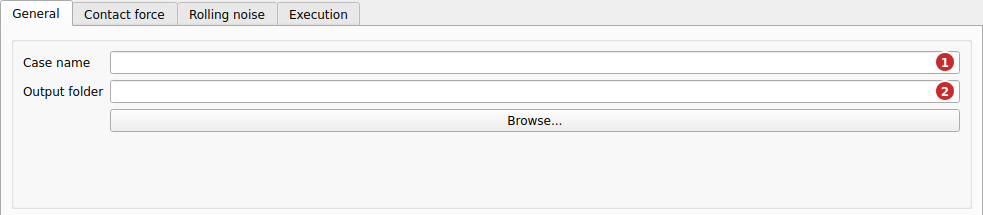
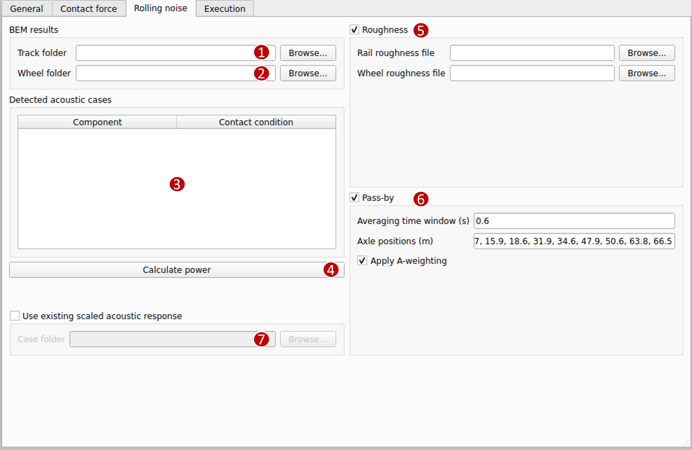

## 7.1 Overview

The **Post-processing** module combines the structural and acoustic results of the track and wheels calculated with the previous modules to predict the rolling noise generated by the wheel–rail interaction.

The main processing workflow is:

1. **Wheel-track interaction**  
   Solve the wheel/track interaction to calculate the contact forces at the wheel/rail contact point generated by a unit vertical roughness.

2. **Scaling of the acoustic response**  
   Multiply the vibro-acoustic transfer functions calculated with the BE models by the corresponding contact forces for unit roughness.

3. **Roughness**  
   Apply the contact filtered combined roughness of the wheel and rail.

4. **Pass-by**  
   Construct pass-by signals and spectra for single or multiple train axles.

### Assumptions

- The effects of wheel rotation on the wheelset dynamics are neglected.
- Wheel conicity and rail tilt are not accounted for in the contact formulation.
- Longitudinal and spin creepage are neglected.

The main inputs of the module are:

- the **wheelset contact FRFs** calculated with the Wheelset FE model;
- the **track contact FRFs** calculated with the Multi-Sleeper Model;
- the **acoustic transfer functions** calculated with the BE model;
- the **rail and/or wheel roughness spectra**.

The graphical interface is divided into four tabs:

- **General**
- **Contact force**
- **Rolling noise**
- **Execution**

## 7.2 General

The **General** tab defines the case name and output location for the post-processing results.



**1 — Case name**  

Enter a name for the post-processing case. A folder with this name is created in which the results are stored.

The case name must not contain spaces or path separators.

**2 — Output folder**  

Select the folder where the post-processing results will be stored.

## 7.3 Contact force

The **Contact force** tab defines the inputs for the wheel/track interaction model.


**1 — Calculate contact force**

Select this option to calculate the contact forces from the wheelset and track contact FRFs.

The wheel/track interaction model is based on the frequency-domain moving roughness approach described by Thompson [1]. The wheel and track are coupled through a contact spring and creep forces at the contact.

The interaction model considers two degrees of freedom at the contact point: the vertical direction ($y$) and the lateral direction ($z$). The dynamic contact forces for roughness excitation, which include the vertical and lateral force components $F_y$ and $F_z$, are calculated in the frequency domain as:

```math
\begin{bmatrix}
F_y \\
F_z
\end{bmatrix}
=
\left[
\mathbf{Y}^{\mathrm{W}}+
\mathbf{Y}^{\mathrm{R}}+
\mathbf{Y}^{\mathrm{C}}
\right]^{-1}
\begin{bmatrix}
i\omega R \\
0
\end{bmatrix}
```

where $\mathbf{Y}^{\mathrm{W}}$, $\mathbf{Y}^{\mathrm{R}}$ and $\mathbf{Y}^{\mathrm{C}}$ denote the mobility matrices of the wheel, track and contact zone, respectively, and $R$ is the roughness amplitude.

The wheel and track mobility matrices include the driving-point and cross-mobilities:

```math
\mathbf{Y_{wheel, rail}}=
\begin{bmatrix}
Y_{yy} & Y_{yz} \\
Y_{zy} & Y_{zz}
\end{bmatrix}
```

> [!NOTE]
> The contact forces are calculated for **unit roughness** acting in the vertical direction.

**2 & 3 — Train speed and wheel load**

Define the train speed [km/h] and the static load applied on one wheel [N]. The two parameters are used to calculate the contact zone mobility matrix. 

The wheel load determines the dimensions of the contact patch and the contact stiffness. The train speed is used in the calculation of the lateral contact mobility.

The contact zone mobility matrix is given by [1]:

```math
\mathbf{Y}^{\mathrm{C}}(\omega)=
\begin{bmatrix}
\dfrac{i\omega}{K_H} & 0 \\[8pt]
0 & \dfrac{v}{G a b C_{22}^{*}}
\end{bmatrix}
```

where:

- $K_H$ is the linearised vertical Hertzian contact stiffness;
- $a$ and $b$ are the semi-axes of the elliptical contact patch in the rolling and transverse directions, respectively;
- $G$ is the shear modulus;
- $v$ is the train speed;
- $C_{22}^{*}$ is the frequency dependent creep coefficient [1].

The wheel transverse and rail longitudinal radii of curvature are assumed infinite, the rail transverse radius of curvature is set to 0.3 m and the wheel rolling radius is obtained from the wheelset FE model. The material properties used for the contact model are fixed at a Young's modulus of 210 GPa and a Poisson's ratio of 0.3.

**4 & 5 — Add/remove**

Add or remove the defined train speed and wheel load to/from the parameter table.

**6 — Parameter sets table**

The contact forces are calculated separately for each combination of train speed and wheel load added to the table.

Each parameter set is stored in a separate folder using the following naming convention:

`V<speed>_F<load>`

For example, `V120_F54000` corresponds to a train speed of 120 km/h and a wheel load of 54 kN.

**7 — Use simulation results folder**

Select this option to use the contact FRFs calculated with the structural models for **predefined tracks and wheels**.

Select the wheelset and track structural results folder generated by the FE models. The folder contains the results for the different selected contact positions (`nominal`, `midSpan_nominal`...etc). The contact forces are calculated for each contact condition.

All available wheel and track contact conditions are combined. For example, three wheel contact positions and nine track contact conditions result in 27 wheel/track contact cases.

**8 — Use FRF files**

Select this option to provide the wheelset and track contact FRFs manually. It enables the calculation of contact forces for wheels and tracks that do not belong to the predefined cases. 

> [!NOTE]
> For custom meshes, currently only contact-force calculation is possible with the GUI.

Select the vertical and lateral contact FRF files and the corresponding parameter file (JSON) for both the wheelset and track. An example of the required files and their placement within the results folder is shown in the table below:

| Input | Required file |
|---|---|
| Wheels vertical contact FRF | `wheel_structural/<contact position>/vertical/Outputs/FRFcontact_vert.txt` |
| Wheels Lateral contact FRF | `wheel_structural/<contact position>/lateral/Outputs/FRFcontact_lat.txt` |
| Wheels parameters (JSON) | `wheel_structural/<contact position>/lateral/parameters.json` |
| Track vertical contact FRF | `track_structural/<contact position>/vert/Outputs/FRF.txt` |
| Track lateral contact FRF | `track_structural/<contact position>/lat/Outputs/FRF.txt` |
| Track parameters (JSON) | `track_structural/<contact position>/lat/parameters.json` |

> [!WARNING]
> **TODO:** Extend the track contact FRF reader to support custom force nodes instead of only the nine predefined contact positions.

**9 — Use existing contact force**

Select this option to reuse the contact forces calculated in a previous post-processing case.

Select the folder corresponding to the previous post-processing case. The contact-force files (`Interaction.h5`) are copied to the new case.

## 7.4 Rolling noise

The Rolling noise tab defines the inputs for the acoustic response scaling and pass-by calculations.



**1 & 2 — Track and wheel folders**

Select the track and wheel acoustic results folders generated by the BE models. Both vertical and lateral acoustic transfer functions are required for each component (rail, sleepers and wheel) and contact position.

The acoustic transfer functions calculated for unit force are multiplied by the corresponding contact forces calculated for unit roughness.

The sound pressure at the receiver positions for unit roughness is obtained as:

```math
p_{\mathrm{unit}}^{(i)} =
p_y^{(i)}F_y +
p_z^{(i)}F_z
```

where $p_y^{(i)}$ and $p_z^{(i)}$ are the acoustic transfer functions for vertical and lateral unit forces, respectively, and $i$ denotes the rail, sleepers or wheel.

The vertical and lateral contributions of each component are summed **coherently**. The resulting pressure spectra are converted to **one-third-octave bands** and the contributions of the different components are summed **incoherently**:

```math
p_{\mathrm{total}}^2 =
p_{\mathrm{rail}}^2 +
p_{\mathrm{sleepers}}^2 +
p_{\mathrm{wheel}}^2
```

> [!NOTE]
> The acoustic response can be calculated for individual components. It is not necessary to provide the acoustic transfer functions of all three components.

**3 — Use existing scaled acoustic response**

Select this option to reuse the acoustic responses calculated in a previous post-processing case.

Select the corresponding post-processing results folder.

If the selected case contains only the acoustic responses for unit roughness, the roughness can be applied and the pass-by can be calculated. If the roughness has already been applied, only the pass-by calculation is available.

**4 — Detected acoustic cases**

The table displays the components and the corresponding contact conditions detected in the selected acoustic results folders.

The acoustic transfer functions are associated with the corresponding wheel and track contact conditions for which the contact forces are calculated.

**5 — Calculate power**

Select this option to calculate the radiated sound power of each rail, sleepers and wheel.

The surface normal velocity and surface pressure calculated for vertical and lateral unit forces are multiplied by the corresponding contact forces:

```math
u_n^{(i)} =
u_{n,y}^{(i)}F_y +
u_{n,z}^{(i)}F_z
```

```math
p_s^{(i)} =
p_{s,y}^{(i)}F_y +
p_{s,z}^{(i)}F_z
```

The sound power is then calculated from the resulting complex surface fields:

```math
W^{(i)} = \frac{1}{2}\mathrm{Re}\Big( \int_S p_s^{(i)}\,u_n^{(i)*}\,\mathrm{d}S \Big)
```

where $S$ is the radiating surface and $(\cdot)^*$ denotes the complex conjugate.

The sound power is recalculated after combining the vertical and lateral surface fields to account for the phase relationship between the two excitation directions.

The total radiated sound power is obtained by summing the sound power radiated by each component.

> [!NOTE]
> The sound power calculation requires the `bemData_*.h5` files in addition to the `acouRes_*.h5` files generated by the BE models. Due to the large number of DoF the power calculation might take several minutes. 

**6 — Roughness**

Select this option to apply the contact filtered combined roughness of the wheel and rail to the acoustic responses calculated for unit roughness.

The wheel and rail roughness are assumed to be uncorrelated and are combined as:

```math
r^2 = r_{\mathrm{wheel}}^2 + r_{\mathrm{rail}}^2
```

where $r_{\mathrm{wheel}}$ and $r_{\mathrm{rail}}$ are the wheel and rail roughness amplitudes, respectively.

The roughness wavelengths $\lambda$ are converted to frequencies from the train speed $v$:

```math
f = \frac{v}{\lambda}
```

The finite size of the wheel/rail contact patch reduces the excitation from roughness at short wavelengths (low-pass filter). This effect is accounted for using the following analytical contact filter [1]:

```math
|H(k)|^2 =
\left[
1+\frac{\pi}{4}(ka)^3
\right]^{-1}
```

where $a$ is the semi-axis of the contact patch in the rolling direction and $k$ is the roughness wavenumber:

```math
k = \frac{2\pi}{\lambda}
```

The squared sound pressure and sound power are scaled by the contact filtered combined roughness:

```math
p^2 = p_{\mathrm{unit}}^2 \, r^2 \, |H(k)|^2
```

```math
W = W_{\mathrm{unit}} \, r^2 \, |H(k)|^2
```

The multiplication is performed in one-third-octave bands.

**7 & 8 — Rail and wheel roughness files**

Select the text files containing the rail and/or wheel acoustic roughness spectra in **one-third-octave wavelength bands**. The roughness levels should correspond to the **RMS roughness** in each wavelength band, expressed in dB re 1 µm.

The roughness files should be in `.txt` format and contain the following columns:

| Column | Description | Unit |
|---|---|---|
| 1 | Centre wavelength of the band | m |
| 2 | Roughness level | dB re 1 µm |

The two columns must be separated by spaces or tabs. The files must not contain a header.

If only one roughness file is provided, the roughness of the other component is assumed to be zero.

The frequency range of the resulting acoustic response is limited to the common frequency range covered by the acoustic response and the provided roughness spectra.

**9 — Pass-by**

Select this option to construct the pass-by signals and spectra for single or multiple train axles.

The squared sound pressures calculated for the different wheel/rail contact conditions are averaged with equal weighting:

```math
\overline{p^2} =
\frac{1}{N_c}
\sum_{j=1}^{N_c}p_j^2
```

where $N_c$ is the number of contact conditions included in the pass-by calculation.

Only contact conditions for which the acoustic responses of all detected components are available are included in the averaging.

The pass-by is reconstructed from the acoustic responses calculated at the 501 receivers distributed along the track, from −25 m to +25 m with a spacing of 0.1 m. At each receiver, the sound pressure spectrum is available in one-third-octave bands.

The overall sound pressure level as a function of the longitudinal distance is obtained by summing the squared sound pressures over the frequency bands:

```math
L_p(x)=10\log_{10}\left(
\frac{\sum_j p_j^2(x)}{p_0^2}
\right)
```

where $p_j(x)$ is the sound pressure in the frequency band $j$ at the longitudinal position $x$ and $p_0$ is the reference sound pressure (20 µPa).

Knowing the train speed, the distance between two consecutive receivers can be converted to a time step:

```math
\Delta t=\frac{\Delta x}{v}
```

This allows the reconstruction of the pass-by signal at a fixed receiver position.

The pass-by calculation is performed separately for each combination of train speed and wheel load. Pass-by signals and spectra are calculated for unit roughness and, if available, for the applied roughness.

The frequency range considered in the pass-by calculation is 100 Hz to 5000 Hz.

> [!NOTE]
> The pass-by calculation currently requires the predefined receiver distributions (M75 or M3) described in Chapter 6.

> [!WARNING]
> **TODO:** Adapt the pass-by calculation to read the receiver positions from the acoustic results files instead of using a fixed receiver distribution.

**10 — Averaging time window**

Define the time window [s] over which the pass-by spectra are averaged.

Knowing the train speed, the averaging time window $T$ is converted to a spatial averaging window of length $L$:

```math
L=vT
```

The pass-by spectra are obtained by averaging the squared sound pressure in each frequency band over the spatial window:

```math
p_{j,\mathrm{eq}}^2=
\frac{1}{L}\int_{-L/2}^{L/2}p_j^2(x)\,\mathrm{d}x
```

This is equivalent to a temporal average of the squared sound pressure over the defined time window.

The overall equivalent sound pressure level is obtained by summing the contributions of all frequency bands:

```math
L_{\mathrm{eq}}=10\log_{10}\left(
\frac{\sum_j p_{j,\mathrm{eq}}^2}{p_0^2}
\right)
```

If A-weighting is applied, the corresponding overall level is $L_{\mathrm{A,eq}}$.

The averaging window is centred on the passage of the midpoint between the first and last axles at the receiver position.

**11 — Axle positions**

Define the longitudinal positions of the train axles [m], separated by commas.

For a single axle, enter `0`. For multiple axles, enter their positions relative to the first axle.

The pass-by signal is constructed by shifting the spatial distribution of the squared sound pressure according to the axle positions and summing the contributions of the different axles incoherently. The spatial distribution is then converted to a time signal using the train speed.

**12 — Apply A-weighting**

Select this option to apply A-weighting to the pass-by signals and spectra.
