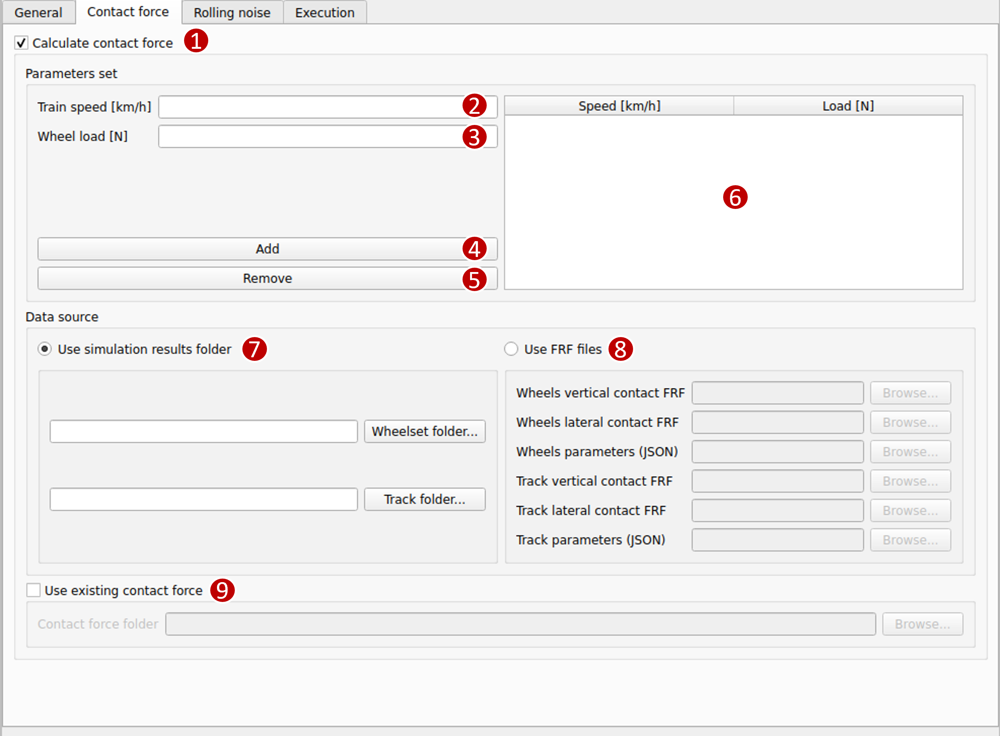

## 7.1 Overview

The **Post-processing** module combines the structural and acoustic results of the track and wheels calculated with the previous modules to predict the rolling noise generated by the wheel–rail interaction.

The main processing workflow is:

1. **Wheel-track interaction**  
   Solve the wheel/track interaction model to calculate the contact forces at the wheel/rail contact point generated by a unit vertical roughness.

2. **Scaling of the acoustic response**  
   Multiply the vibro-acoustic transfer functions calculated with the BE models by the corresponding contact forces for unit roughness.

3. **Roughness**  
   Apply the contact filtered rail and/or wheel roughness spectra.

4. **Pass-by**  
   Construct pass-by signals and spectra for single or multiple train axles.

The main inputs of the module are therefore:

- the **wheelset contact FRFs** calculated with the Wheelset FE model;
- the **track contact FRFs** calculated with the Multi-Sleeper Model;
- the **acoustic transfer functions** calculated with the BE model;
- the **rail and/or wheel roughness spectra**.

The graphical interface is divided into four tabs:

- **General**
- **Contact force**
- **Rolling noise**
- **Execution**

### 7.1.1 Calculation approach and assumptions

**Wheel/track interaction**

The wheel/track interaction model is based on the approach described by Thompson [1]. The wheel and track are coupled through the vertical contact stiffness and the lateral creep forces at the wheel/rail contact point.

In the vertical direction, the contact is represented by a linearised Hertzian contact spring. In the lateral direction, the contact is represented by a spring and a damper in series, accounting for the elastic deformation of the contact zone and the lateral creep forces based on Kalker's theory [2].

The dimensions of the contact patch and the contact stiffnesses are calculated using Hertzian contact theory.

The interaction model considers two degrees of freedom at the contact point (vertical and lateral). The contact forces are calculated in the frequency domain as:

```math
\begin{bmatrix}
F_y \\
F_z
\end{bmatrix}
=
\left[
\mathbf{Y}^{\mathrm{W}} +
\mathbf{Y}^{\mathrm{R}} +
\mathbf{Y}^{\mathrm{C}}
\right]^{-1}
\begin{bmatrix}
i\omega R \\
0
\end{bmatrix}
```

where $\mathbf{Y}^{\mathrm{W}}$, $\mathbf{Y}^{\mathrm{R}}$ and $\mathbf{Y}^{\mathrm{C}}$ are the mobility matrices of the wheel, track and contact zone, respectively, and $R$ is the roughness amplitude.

The roughness excitation is applied in the vertical direction only. The lateral contact force results from the coupling between the vertical and lateral responses of the wheel and track, through the cross-mobility terms.

The following assumptions are made in the interaction model:

- The effects of wheel rotation on the wheelset dynamics are neglected.
- The influence of wheel conicity on the contact angle and contact geometry is neglected.
- Longitudinal and spin creepage are neglected.
- The wheel transverse and rail longitudinal radii of curvature are assumed infinite.
- The rail transverse radius of curvature is set to 0.3 m.
- The material properties used for the contact model are fixed at a Young's modulus of 210 GPa and a Poisson's ratio of 0.3.

**Scaling of the acoustic response**

The acoustic transfer functions calculated for vertical and lateral unit forces are multiplied by the corresponding contact forces for unit roughness.

For each component (rail, sleepers and wheel), the resulting sound pressure at the receiver positions is obtained as:

$$
p_{\mathrm{unit}} =
p_{\mathrm{vert}}F_{\mathrm{vert}} +
p_{\mathrm{lat}}F_{\mathrm{lat}}
$$

The vertical and lateral contributions are summed coherently.

For the sound power calculation, the surface normal velocity and surface pressure fields are scaled and combined in the same way. The sound power is then recalculated from the resulting complex surface fields, accounting for the phase relationship between the two excitation directions.

**Roughness and contact filter**

The roughness wavelengths are converted to frequencies according to:

$$
f = \frac{v}{\lambda}
$$

where $v$ is the train speed and $\lambda$ is the roughness wavelength.

The rail and wheel roughness spectra are combined energetically:

$$
r^2 = r_{\mathrm{rail}}^2 + r_{\mathrm{wheel}}^2
$$

The finite dimensions of the wheel/rail contact patch reduce the excitation from roughness at short wavelengths. This effect is accounted for using the contact filter described in [1]:

$$
|H(k)|^2 =
\left[
1+\frac{\pi}{4}(ka)^3
\right]^{-1}
$$

where $a$ is the semi-axis of the contact patch in the rolling direction and $k=2\pi/\lambda$ is the roughness wavenumber.

The acoustic responses for unit roughness are scaled by the contact-filtered roughness in one-third-octave bands:

$$
p^2 = p_{\mathrm{unit}}^2 \, r^2 \, |H(k)|^2
$$

$$
W = W_{\mathrm{unit}} \, r^2 \, |H(k)|^2
$$

The acoustic contributions of the rail, sleepers and wheel are summed incoherently.

**Pass-by**

The acoustic responses calculated for the different wheel/rail contact positions are averaged energetically with equal weighting.

The pass-by signal is constructed from the spatial distribution of the sound pressure along the track, accounting for the train speed and the positions of the axles. The contributions of the individual axles are summed incoherently.

The pass-by spectra are calculated over a defined averaging time window. The frequency range considered for the pass-by is 100 Hz to 5000 Hz.

**References**

[1] Thompson, D. J. (2009). Railway Noise and Vibration: Mechanisms, Modelling and Means of Control. Elsevier.

[2] Kalker, J. J. (1967). On the rolling contact of two elastic bodies in the presence of dry friction. Doctoral thesis, Delft University of Technology.

## 7.2 General

The **General** tab defines the case name and output location for the post-processing results.


**1 — Case name**  

Enter a name for the post-processing case. A folder with this name is created in which the results are stored.

The case name must not contain spaces or path separators.

**2 — Output folder**  

Select the folder where the post-processing results will be stored.

## 7.3 Contact force

The **Contact force** tab defines the inputs for the wheel/track interaction model.



**1 — Use existing contact force**

Select this option to reuse the contact forces calculated in a previous post-processing case.

**2 — Contact force folder**

Select the folder corresponding to the previous post-processing case. The contact-force files (`Interaction.h5`) are copied to the new case.

**3 — Calculate contact force**

Select this option to calculate the contact forces from the wheelset and track contact FRFs.

The wheel/track interaction model is based on the approach described by Thompson [1]. The wheel and track are coupled through the vertical contact stiffness and the lateral creep forces at the wheel/rail contact point.

The interaction model considers two degrees of freedom at the contact point: the vertical direction ($y$) and the lateral direction ($z$). The contact forces are calculated in the frequency domain as:

```math
\begin{bmatrix}
F_y \\
F_z
\end{bmatrix}
=
\left[
\mathbf{Y}^{\mathrm{W}}+
\mathbf{Y}^{\mathrm{R}}+
\mathbf{Y}^{\mathrm{C}}
\right]^{-1}
\begin{bmatrix}
i\omega R \\
0
\end{bmatrix}
```

where $\mathbf{Y}^{\mathrm{W}}$, $\mathbf{Y}^{\mathrm{R}}$ and $\mathbf{Y}^{\mathrm{C}}$ denote the mobility matrices of the wheel, track and contact zone, respectively, and $R$ is the roughness amplitude.

The wheel and track mobility matrices include the driving-point and cross-mobilities:

```math
\mathbf{Y}^{(i)}=
\begin{bmatrix}
Y_{yy}^{(i)} & Y_{yz}^{(i)} \\
Y_{zy}^{(i)} & Y_{zz}^{(i)}
\end{bmatrix},
\qquad i\in\{\mathrm{W},\mathrm{R}\}
```

The roughness excitation is applied in the vertical direction only. The lateral contact force results from the coupling between the vertical and lateral dynamics of the wheel and track.

The contact forces are calculated for unit vertical roughness.

**4 — Train speed**

Define the train speed [km/h].

**5 — Wheel load**

Define the static load applied to one wheel [N].

The wheel load determines the dimensions of the contact patch and the contact stiffnesses. The train speed enters the calculation of the lateral contact mobility.

In the vertical direction, the contact is represented by a linearised Hertzian contact spring. In the lateral direction, the contact is represented by a spring and a creep damper in series, following Thompson [1] and based on Kalker's linear creep theory [2].

The contact zone mobility matrix is given by:

```math
\mathbf{Y}^{\mathrm{C}}(\omega)=
\begin{bmatrix}
\dfrac{i\omega}{K_H} & 0 \\[8pt]
0 & \dfrac{v}{G a b C_{22}^{*}(\omega)}
\end{bmatrix}
```

where:

- $K_H$ is the linearised vertical Hertzian contact stiffness;
- $a$ and $b$ are the semi-axes of the elliptical contact patch in the rolling and transverse directions, respectively;
- $G$ is the shear modulus;
- $v$ is the train speed;
- $C_{22}^{*}$ is the frequency-dependent lateral creep coefficient.

The following assumptions are made in the wheel/track interaction model:

- The effects of wheel rotation on the wheelset dynamics are neglected.
- The influence of wheel conicity on the contact angle and geometry is neglected.
- Longitudinal and spin creepage are neglected.
- The wheel transverse and rail longitudinal radii of curvature are assumed infinite.
- The rail transverse radius of curvature is set to 0.3 m.
- The wheel rolling radius is obtained from the wheelset model.
- The material properties used for the contact model are fixed at a Young's modulus of 210 GPa and a Poisson's ratio of 0.3.

**6 — Add**

Add the defined train speed and wheel load to the parameter table.

**7 — Parameter sets**

The contact forces are calculated separately for each combination of train speed and wheel load added to the table.

Each parameter set is stored in a separate folder using the following naming convention:

`V<speed>_F<load>`

For example, `V120_F54000` corresponds to a train speed of 120 km/h and a wheel load of 54 kN.

**8 — Use simulation results folder**

Select this option to use the contact FRFs calculated with the Wheelset FE and Multi-Sleeper Model.

**9 — Wheelset folder**

Select the wheelset simulation folder. The available wheel contact positions are detected automatically.

- `nominal`
- `offsetIN`
- `offsetOUT`

**10 — Track folder**

Select the track simulation folder. The available track contact conditions are detected automatically.

- `midSpan_nominal`
- `midSpan_offsetIN`
- `midSpan_offsetOUT`
- `quarterSpan_nominal`
- `quarterSpan_offsetIN`
- `quarterSpan_offsetOUT`
- `onSleeper_nominal`
- `onSleeper_offsetIN`
- `onSleeper_offsetOUT`

All available wheel and track contact conditions are combined. For example, three wheel contact positions and nine track contact conditions result in 27 wheel/track contact cases.

**11 — Use FRF files**

Select this option to provide the wheelset and track contact FRFs manually.

**12 — Contact FRF files**

Select the vertical and lateral contact FRF files and the corresponding parameter file (JSON) for both the wheelset and track.

This option currently supports the contact-force calculation only.
