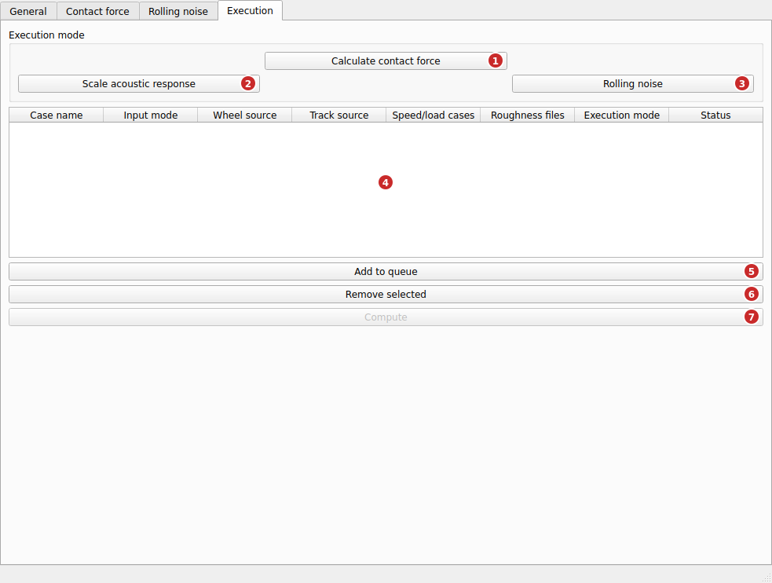

# 7. Post-processing: contact force, rolling noise, pass-by

**Checklist for this chapter**

- [ ] I have the contact FRFs of the wheelset (chapter 5) and of the track (chapter 4), and the BEM results (chapter 6).
- [ ] I have a roughness file for the rail, for the wheel, or for both (section 7.5).
- [ ] I have opened **Post-processing** from the launcher.
- [ ] On the **General** tab: I have given a case name and an output folder.
- [ ] On the **Contact force** tab: I have entered at least one pair *train speed* and *wheel load*, and chosen the folders of the wheelset and of the track.
- [ ] On the **Rolling noise** tab: I have chosen the BEM folders, the roughness files and the pass-by parameters.
- [ ] On the **Execution** tab: I have chosen the steps to run, added the case to the queue, and clicked **Compute**.
- [ ] The queue shows *Finished*, and the result folders contain the files of section 7.7.

## 7.1 What this module does

The Post-processing module turns the results of the three other modules into **rolling noise**. It works in four steps:

1. **Contact force**: for each train speed and wheel load, it computes the force at the wheel–rail contact that a unit roughness produces. It uses the contact FRFs of the wheelset and of the track, and a model of the contact patch between the wheel and the rail.
2. **Scaling of the acoustic response**: it multiplies the acoustic transfer functions of the BEM (pascals per newton) by this contact force. This gives the sound pressure at the receivers *per unit roughness*, for the rail, the sleepers and the wheel.
3. **Roughness**: it multiplies the result by the roughness spectra of the rail and of the wheel. This gives the sound pressure at the receivers.
4. **Pass-by**: it combines the pressures of all the axles of a train, to get the sound pressure as a function of time and averaged spectra.

You can run these steps one after another, or all at once. Each step reads the files written by the previous one.

**How the result is built** — keep this in mind when you interpret it:

- The wheel and the track are described by their **frequency responses** at the contact. The speed enters through the contact patch, through the conversion of the roughness wavelength to a frequency, and through the time axis of the pass-by. There is no Doppler effect.
- Only a **vertical roughness** is applied. The lateral force comes from the coupling between the vertical and the lateral directions.
- The vertical and the lateral contributions of one component are added with their **phases**. The rail, the sleepers and the wheel are then added as **energies**, in third-octave bands. The rail roughness and the wheel roughness are also added as energies, and so are the axles.
- The contact positions (along the span, across the rail head) are averaged with the same weight.
- One rail and one wheel per axle are included, in free field: there is no ground and no second rail or wheel.
- The pass-by uses the third-octave bands from **100 Hz to 5 kHz**.

<!-- TODO(fix pending P4): check with the developers that leaving out the second wheel and rail, and the ground, is intended. -->

## 7.2 What you need before you start

**Wheelset results** (chapter 5): a folder, for example `wheel_study`, which contains one folder for each force position. The name of each of them must **end with** `nominal`, `offsetIN` or `offsetOUT`, and each must contain:

- `vertical/Outputs/FRFcontact_vert.txt`,
- `lateral/Outputs/FRFcontact_lat.txt`,
- `parameters.json`.

**Track results** (chapter 4): a folder, for example `track_study`, which contains one folder for each contact case. The name of each of them must **end with** `midSpan_`, `quarterSpan_` or `onSleeper_` followed by `nominal`, `offsetIN` or `offsetOUT`, and each must contain:

- `vert/Outputs/FRF.txt` and `lat/Outputs/FRF.txt`,
- `parameters_vert.json` and `parameters_lat.json`.

The track folder can also contain a file `TDR.txt` (the track decay rate), which is drawn in a figure.

<!-- TODO(fix pending P1): the track FRFs in velocity cannot be read. Say which FRF type to choose in the Multi-Sleeper Model. -->

**BEM results** (chapter 6): the case folders `track_study` and `wheel_study` (the BEM case names), with both force directions for each component.

**Roughness files**: see section 7.5.

**Contact cases.** The module combines **every wheel position with every track contact case** that it finds. A wheelset folder with 3 positions and a track folder with 9 contact cases give 27 contact cases, named `W<wheel>_T<track>`, for example `Wnominal_TmidSpan_nominal`. The results are computed and kept for each of them.

## 7.3 Step 1: the *General* tab


*Figure 7.1 — The General tab.*

1. **Case name**: a name for this study, for example `rolling_noise`. It must not contain spaces or `/`.
2. **Output folder**: an existing folder inside your home directory. The results are written in a folder `<Output folder>/<Case name>`.

If this folder already exists, you are asked, when you click **Compute**, whether you accept to overwrite it. It is **deleted before the calculation starts**.

## 7.4 Step 2: the *Contact force* tab


*Figure 7.2 — The Contact force tab.*

The two options **1** and **3** exclude each other: exactly one of them is ticked.

1. **Use existing contact force**: tick it to reuse the contact force of an earlier case, instead of computing it again. The earlier case is copied into the new one.
2. **Contact force folder**: the case folder of the earlier calculation.
3. **Calculate contact force** (the default): compute the contact force.

**Parameters set**: the pairs of speed and load for which the contact force is calculated.

4. **Train speed [km/h]** and
5. **Wheel load [N]**: the speed of the train and the **static load on one wheel**, in newtons.
6. **Add**: adds the pair to the table. A pair that is already in the table is refused.
7. **Table of the pairs**: one calculation is done for each pair. Select rows and click **Remove** to delete them. You need at least one pair.

   Each pair has its own result folder, called `V<speed>_F<load>`, for example `V100_F50000` for 100 km/h and 50 000 N. A decimal point is written `p`: 99.5 km/h gives `V99p5_F…`.

**Data source**: where the frequency responses of the wheelset and of the track come from.

8. **Use simulation results folder** (the default): the module reads the results of the previous chapters.
9. **Wheelset folder…**: click it and choose the folder of the wheelset results (for example `wheel_study`), not one of its position folders.
10. **Track folder…**: click it and choose the folder of the track results (for example `track_study`).
11. **Use FRF files**: to use frequency responses that were not computed by ToPNoise.
12. **The six fields of this mode**: the vertical and lateral contact FRFs and the parameters file (JSON) of the wheel, and the same three for the track. This mode computes **one** contact case, called `contact1`, and **only the contact force**: you cannot continue with the acoustic steps.

<!-- TODO(fix pending P2): check the sign convention of the wheel cross-mobilities with the developers (the finite-element wheel has its contact at the top). -->

## 7.5 Step 3: the *Rolling noise* tab


*Figure 7.3 — The Rolling noise tab.*

**BEM results**

1. **Track folder**: the case folder of the BEM results of the track (for example `track_study`).
2. **Wheel folder**: the case folder of the BEM results of the wheel (for example `wheel_study`).

   You can give only one of them. Only the components found are used.
3. **Use existing scaled acoustic response**: tick it to reuse the acoustic response of an earlier case, and run only the roughness and the pass-by. Choose the case folder in the field below. The earlier case is copied into the new one.
4. **Detected acoustic cases**: after you have chosen the BEM folders, this table lists the components and the contact cases found in them. **Look at it**: if it is empty, or if a component is missing, the folders do not follow the structure of section 7.2.
5. **Calculate power**: tick it to also compute the radiated **sound power** (it needs the files `bemData_….h5` next to the `acouRes_….h5`, and it is slower).

**Roughness**

6. **Roughness** (ticked by default): untick it if you only want the response per unit roughness.
7. **Rail roughness file** and
8. **Wheel roughness file**: one file for the rail, one for the wheel; you need at least one. Each file is a text file with **two columns**, without header: the **wavelength in metres** and the **roughness level in dB** (re 1 µm), separated by spaces. The speed converts a wavelength into the frequency at which it excites the wheel and the rail: *frequency = speed / wavelength*.

   The wavelengths of the file must cover the frequencies of interest: at 100 km/h, the bands from 100 Hz to 5 kHz correspond to wavelengths from about 280 mm to 5.6 mm. The bands that the file does not cover are **left out of the results without warning**.

**Pass-by**

9. **Pass-by** (ticked by default): untick it if you do not need the pass-by.
10. **Averaging time window (s)**: the length of time over which the pass-by spectra are averaged, centred on the moment when the middle of the train passes the receiver. The default is 0.6 s.
11. **Axle positions (m)**: the positions of all the axles of the train along its length, separated by commas. Only the distances between the axles matter. The default is a train with ten axles.
12. **Apply A-weighting**: the levels are given in dB(A) (ticked by default).

The pass-by uses the receivers of the BEM as positions along the track, from −25 m to +25 m. It therefore needs the BEM results with the default receivers (chapter 6).

<!-- TODO(fix pending P3): custom BEM receivers cannot be used for the pass-by. -->
<!-- TODO: what a roughness file looks like in practice (wavelength bands, one file per speed?). -->

## 7.6 Step 4: the *Execution* tab, run the calculation



*Figure 7.4 — The Execution tab.*

The three buttons **1**, **2** and **3** are the steps of section 7.1. You can switch them on in any combination.

1. **Calculate contact force**: step 1. It is not available when you reuse an existing contact force.
2. **Scale acoustic response**: step 2. It needs the BEM folders of the Rolling noise tab.
3. **Rolling noise**: steps 3 and 4. It switches on *Scale acoustic response* by itself. It needs the *Roughness* box or the *Pass-by* box of the Rolling noise tab, or both.

| You want | Switch on |
|---|---|
| The contact force only | 1 |
| The acoustic response per unit roughness | 1 and 2 |
| The whole chain, up to the pass-by | 1, 2 and 3 |
| A new roughness or pass-by, from an earlier case | *Use existing scaled acoustic response* (Rolling noise tab) and 3 |

4. **Queue**: the list of cases. Each row shows the case name, the input mode, the wheel and track sources, the pairs of speed and load, the roughness files, the execution mode and the *Status*.
5. **Add to queue**: checks the inputs of all the tabs, then adds **one row**. A message tells you what to correct if an input is missing or wrong. The same case name in the same output folder cannot be added twice.
6. **Remove selected**: removes the selected row.
7. **Compute**: runs the rows one after the other. It is available when the queue is not empty.

**To run:**

1. Fill in the four tabs, choose the steps on the Execution tab, and click **Add to queue**.

   **Expected result**: one row with the status `Queued`.
2. Click **Compute**. If the case folder already exists, confirm that it can be overwritten.

   **Expected result**: the status becomes `Running`, then `Finished`, and a window says `Calculations finished.` **The window of the module does not respond while it computes**: wait, and do not close it. The terminal window of the module shows the messages of the calculation.

If a step fails, a window shows the error, the row gets the status `Failed`, and the calculation stops. The rows after it are not run.

<!-- TODO(fix pending P5): the window freezes during the calculation, and the old case folder is deleted before the calculation starts. -->
<!-- TODO: typical computation times for the contact force, the scaling and the pass-by (from the reference case). -->

## 7.7 The results

For a case called `rolling_noise`, with one speed and load, the output folder contains:

```
rolling_noise/
  TDR.png                            the track decay rate, if the track folder contains TDR.txt
  Roughness/                         copies of the roughness files you used
  ContactFRFs/                       the contact FRFs of each contact case, converted to mobilities
  V100_F50000/                       one folder for each pair of speed and load
    Wnominal_TmidSpan_nominal/       one folder for each contact case
      Interaction.h5                   the contact force and the models behind it
      ContactForce.png                 the contact force as a function of frequency
      Response_unit_rail.h5            the sound pressure per unit roughness, for the rail
      Response_unit_sleepers.h5        … for the sleepers
      Response_unit_wheel.h5           … for the wheel
      Response_unit_total.h5           … for the three components together
      Response_rail.h5, Response_sleepers.h5, Response_wheel.h5, Response_total.h5
                                       the same, with the roughness
    Wnominal_TmidSpan_offsetIN/  …
    Pass-by/
      spectra.png, spectra.h5          the averaged pass-by spectra
      signal.png, signal.h5            the pass-by as a function of time
      spectra_unit.png, signal_unit.png, …   the same, for a unit roughness
```

**The figures**

- `ContactForce.png`: the amplitude of the vertical and of the lateral contact force, as a function of frequency (both axes logarithmic), for one contact case, in newtons for a unit roughness.
- `Pass-by/spectra.png`: the sound pressure level in third-octave bands, in dB(A) re 20 µPa. The thick black line is the total, with its overall level in the legend (`LAeq` in dB(A), or `Leq` in dB if you switched the A-weighting off), and the coloured lines are the rail, the sleepers and the wheel. The grey lines are the individual contact cases, which are listed at the bottom left of the figure.
- `Pass-by/signal.png`: the sound pressure level as a function of time, for the total and for each component, as the train passes.
- The figures marked `_unit` show the response for a **unit roughness**: their levels are in dB re 20 µPa **per metre of roughness**. They are used to compare the vehicles and the tracks without the influence of the roughness.

The `.h5` files can be read with any HDF5 viewer or with Python and `h5py`. In the files `Response_….h5`, the dataset `pressure3` holds the sound pressure in the third-octave bands, in pascals, for each receiver.

**How to check a result**

1. The row of the queue has the status `Finished`.
2. The folder of each pair of speed and load contains one folder for each contact case, and each contains `Interaction.h5` and the files `Response_….h5` that you asked for.
3. Open `ContactForce.png`: the curves must look smooth, without gaps.
4. Open `Pass-by/spectra.png`: the black line must follow the coloured ones, and the overall level must be plausible for your case.

<!-- TODO: expected contact force and levels for the reference case. -->
<!-- TODO(fix pending B1): the time convention of the BEM pressures. -->

## 7.8 Reuse an earlier case

The steps before the roughness do not depend on the roughness. To try other roughness spectra, or other pass-by parameters, without computing these steps again:

1. On the **Rolling noise** tab, tick **Use existing scaled acoustic response** and choose the case folder of the earlier calculation.
2. Choose the roughness files and the pass-by parameters, and switch on **Rolling noise** only on the Execution tab.
3. Give a **new case name**, add to the queue, and click **Compute**.

In the same way, **Use existing contact force** on the Contact force tab lets you change the BEM results or the roughness without computing the contact force again.

## 7.9 Limits to keep in mind

- The pass-by covers the third-octave bands from 100 Hz to 5 kHz.
- The frequencies of the results are the ones that **the track, the wheelset and the roughness all cover**. The Multi-Sleeper Model proposes 5 Hz to 2000 Hz by default: with it, the bands above 2 kHz are empty, and the overall level is lower than it would be with the whole range.
- The level you get is the level of the **near-side rail and wheel**, in free field (section 7.1).
- The contact parameters are fixed: steel with a Young's modulus of 210 GPa and a Poisson's ratio of 0.3, and a rail head of transverse radius 0.3 m.
- The frequency responses of the track must be computed on a frequency grid fine enough for the interpolation done by the module.

## 7.10 What next

Go on with the worked example in [chapter 8](08-end-to-end.md), or see [chapter 9](09-troubleshooting.md) if something does not work.
